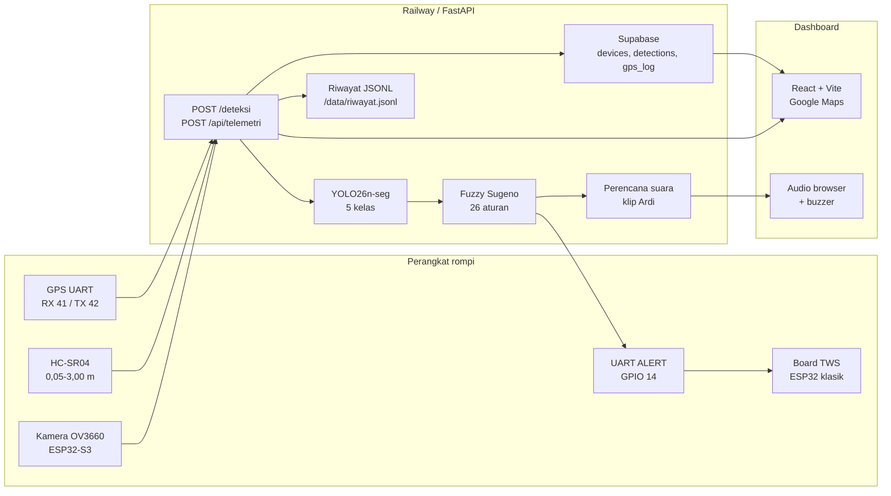
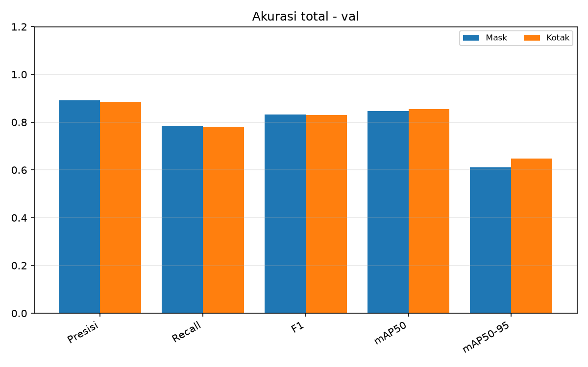
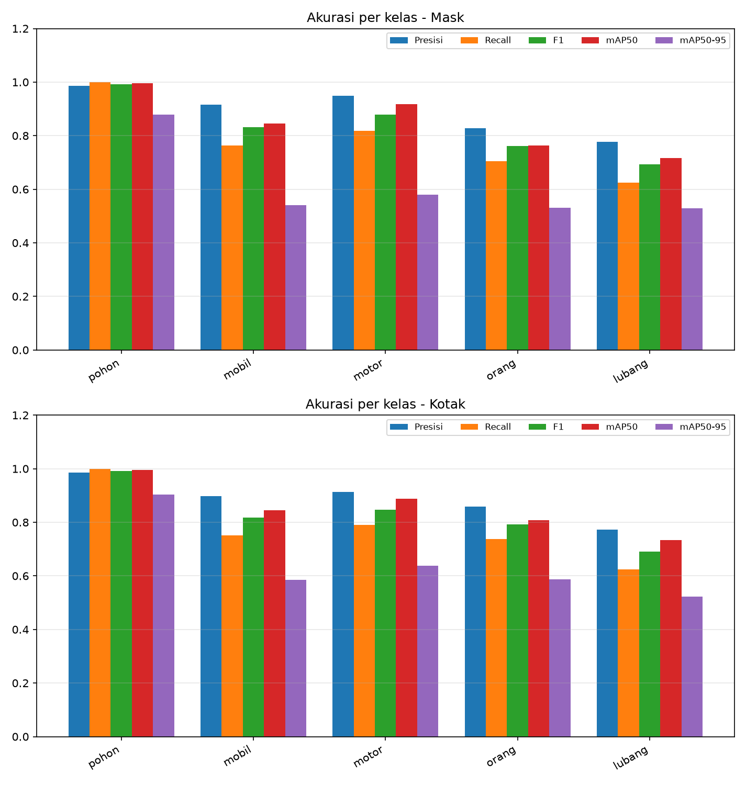
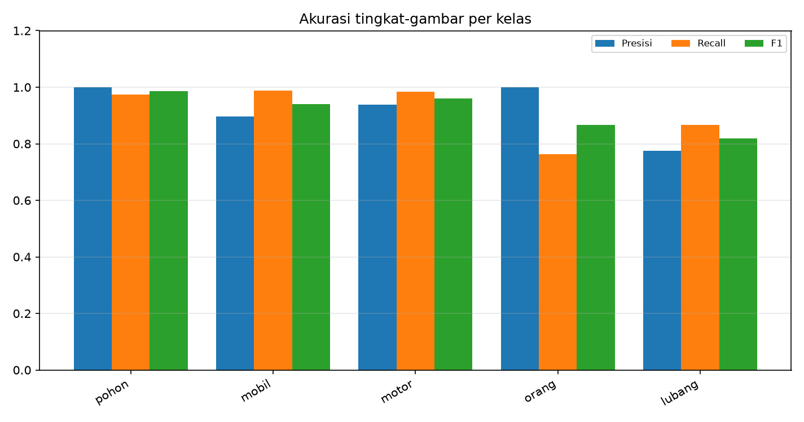
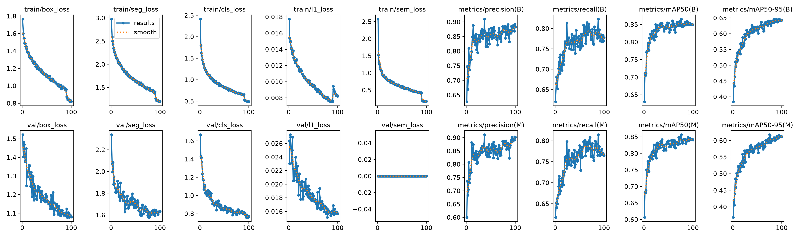

<p align="center">
  
</p>

# VestCare Stage 2 - Rompi Cerdas Pendeteksi Rintangan

VestCare adalah sistem peringatan rintangan untuk rompi cerdas yang ditujukan bagi siswa tunanetra. Sistem menggabungkan segmentasi objek YOLO26n-seg, logika fuzzy Sugeno, suara natural Bahasa Indonesia, sensor ultrasonik, GPS, dan dashboard pemantauan berbasis React. Model mendeteksi lima kelas utama: **pohon, mobil, motor, orang, dan lubang**. Hasil deteksi dipetakan menjadi arah, jarak, tingkat urgensi, instruksi suara, dan sinyal peringatan ke perangkat.

Jalur produksi yang didokumentasikan di README ini adalah **Railway** dengan satu service Docker yang menyajikan API FastAPI sekaligus dashboard React. Database opsional memakai **Supabase**, dan perangkat utama memakai **ESP32-S3 N16R8 + kamera OV3660**.

> Catatan penting: quality gate 98% pada run final **belum terpenuhi**. Pipeline tidak mengganti bobot aktif secara otomatis (`passed: false`, `deployed: false`). `models/best.pt` adalah bobot yang dipilih untuk serving dan dipakai oleh API. Angka evaluasi di README ini berasal dari split validasi, bukan split test independen.

## Daftar isi

- [Ringkasan sistem](#ringkasan-sistem)
- [Status artefak](#status-artefak)
- [Arsitektur end-to-end](#arsitektur-end-to-end)
- [Hardware dan firmware](#hardware-dan-firmware)
- [Model dan training](#model-dan-training)
- [Hasil evaluasi](#hasil-evaluasi)
- [Logika fuzzy Sugeno](#logika-fuzzy-sugeno)
- [API, dashboard, dan Supabase](#api-dashboard-dan-supabase)
- [Pengujian end-to-end](#pengujian-end-to-end)
- [Deploy Railway](#deploy-railway)
- [Menjalankan lokal](#menjalankan-lokal)
- [Struktur proyek](#struktur-proyek)
- [Artefak dan log](#artefak-dan-log)
- [Catatan dan batasan](#catatan-dan-batasan)

## Ringkasan sistem

| Komponen | Keterangan |
|---|---|
| Nama sistem | VestCare Stage 2 - rompi cerdas pendeteksi rintangan |
| Pengguna | Siswa tunanetra dan pendamping di lingkungan sekolah |
| Model visi | YOLO26n-seg, 5 kelas, keluaran bounding box dan mask |
| Kelas | `pohon`, `mobil`, `motor`, `orang`, `lubang` |
| Logika keputusan | Fuzzy Sugeno orde-nol, 26 aturan, skor urgensi 0-100 |
| Keluaran peringatan | Level `AMAN`, `INFO`, `WASPADA`, `BAHAYA`; rencana suara; sinyal `alert` 0/1/2 |
| Suara | Klip Bahasa Indonesia `id-ID-ArdiNeural` dari `data/runtime/audio/cache_ardi` |
| Perangkat | ESP32-S3 N16R8, kamera OV3660, HC-SR04, GPS UART, UART alert ke board TWS |
| Server | FastAPI + Uvicorn, API key, cookie sesi HttpOnly, SSE |
| Web | Dashboard React + Vite, disajikan langsung oleh FastAPI |
| Penyimpanan | Riwayat lokal JSONL dan sinkronisasi opsional ke Supabase |
| Database | Supabase: `devices`, `detections`, `gps_log`, `profiles` |
| Deploy | Railway, Dockerfile multi-stage, health check `/readyz`, 1 replica |
| Peta | Google Maps JavaScript API atau mode embed bila kunci belum diisi |
| Autentikasi web | Supabase Auth (email/password atau Google) + cookie sesi API |

## Status artefak

| Item | Nilai |
|---|---|
| Run final | `data/results/run_final/` |
| ID run | `semua_kelas_yolo26n_20261107_154452` |
| Model aktif | `models/best.pt` |
| Arsitektur bobot aktif | 310 layer, 3.084.955 parameter, 10,4 GFLOPs pada `imgsz=512` |
| SHA-256 `models/best.pt` | `6c09ff5f41cc1a1b333604de0cdebb47b1a9eb2489084cac39e2d508db72d0c6` |
| Bobot kandidat | `models/kandidat_20261116_071306.pt` (bukan bobot aktif) |
| Dashboard produksi | `https://vestcare-detection-object-production.up.railway.app` |
| Health check | `GET /readyz` |
| Dokumentasi API | `GET /docs` |
| Database | Supabase, migrasi di `supabase/migrations/` |
| Quality gate | `passed: false`, `deployed: false`; bobot tidak diganti otomatis |
| Evaluasi | Split validasi 312 gambar; tidak ada split test independen |

Angka model di atas diukur langsung dari `models/best.pt` memakai Ultralytics. Ringkasan awal training di log mencatat 309 layer, 3.054.875 parameter, dan 10,3 GFLOPs; setelah checkpoint aktif dimuat, struktur head end-to-end terbaca 310 layer, 3.084.955 parameter, dan 10,4 GFLOPs. Untuk kebutuhan serving, gunakan angka bobot aktif. Model fused untuk inferensi memiliki 137 layer, 2.704.755 parameter, dan 9,1 GFLOPs.

## Arsitektur end-to-end



### Tanggung jawab komponen

| Lapisan | Komponen | Tanggung jawab |
|---|---|---|
| Perangkat | ESP32-S3 N16R8 | Mengambil JPEG, mengirim frame, membaca ultrasonik dan GPS, mengirim telemetri, mengirim UART alert |
| Perangkat | Kamera OV3660 | Menghasilkan frame QVGA 320x240 untuk preview dan inferensi |
| Perangkat | HC-SR04 | Mengukur jarak depan 0,05-3,00 m dengan 5 sampel dan filter median |
| Perangkat | GPS UART | Mengirim latitude, longitude, altitude, kecepatan, satelit, HDOP, dan status fix |
| Perangkat | Board TWS ESP32 klasik | Menerima `ALERT 0/1/2` dari ESP32-S3 dan mengelola audio TWS |
| Edge | Browser | Menampilkan dashboard, memutar klip Ardi, membunyikan buzzer, dan mengirim frame kamera bila dipakai |
| API | `server_rest_api.py` | Validasi API key/cookie, inferensi, fuzzy, suara, riwayat, SSE, Supabase, dan serving dashboard |
| Visi | `InferensiVest` | Menjalankan YOLO26n-seg pada `imgsz=512`, `conf=0.35`, `conf_ragu=0.50` |
| Keputusan | `fuzzysugeno.py` | Fuzzifikasi jarak/bahaya/jalur, 26 aturan Sugeno, level, arah, pelacak gerak, memori lubang |
| Suara | `PerencanaSuara` | Merakit klip awal, objek, jarak, dan solusi sesuai level dan urgensi |
| Data | `_simpan_riwayat` | Menulis JSONL lokal, merotasi file, dan menyinkronkan ke Supabase |
| Web | `useVestData.js` | Membaca `/dashboard/data`, SSE telemetri, SSE deteksi, dan fallback polling |
| Peta | `GpsMap.jsx` | Menampilkan marker rompi, jejak GPS, dan marker objek di Google Maps |
| Deploy | Railway | Membangun image Docker, menjalankan Uvicorn, health check `/readyz`, dan volume `/data` |

### Alur data utama

| Tahap | Aktor | Masukan | Proses | Keluaran | Media |
|---|---|---|---|---|---|
| 1. Akuisisi | ESP32-S3 / browser | Cahaya di depan pengguna | Capture JPEG QVGA atau frame kamera browser | Blob/JPEG | Memori perangkat |
| 2. Kirim frame | ESP32-S3 | JPEG + `X-API-Key` | Multipart ke `POST /deteksi` dengan `sesi=esp32s3-camera` | Request HTTP | HTTPS 443 |
| 3. Preview | ESP32-S3 | JPEG | Kirim terpisah ke `POST /api/esp32/frame` | Frame terbaru di memori | HTTPS 443 |
| 4. Validasi | FastAPI | Multipart | Cek API key/cookie, ukuran maksimum 10 MB, resolusi maksimum 40 MP | Gambar RGB | Memori server |
| 5. Inferensi | YOLO26n-seg | Gambar 512x512 | Deteksi box, mask, confidence untuk 5 kelas | Daftar objek | GPU/CPU server |
| 6. Keputusan | Fuzzy Sugeno | Box, mask, jarak kamera/ultrasonik | Fuzzifikasi, 26 aturan, defuzzifikasi | Urgensi, level, arah, `alert` | Memori server |
| 7. Suara | PerencanaSuara | Daftar deteksi | Pilih objek teratas, rakit klip | Rencana segmen + teks | Memori server |
| 8. Alert fisik | ESP32-S3 | `alert` 0/1/2 | Kirim `ALERT <n>\n` lewat UART 115200 | Sinyal ke board TWS | UART 3,3 V |
| 9. Riwayat | FastAPI | Hasil deteksi | Tulis JSONL, rotasi 5 MB/4.000 entri | `data/runtime/riwayat.jsonl` | Disk container/volume |
| 10. Supabase | FastAPI | Hasil deteksi + posisi | PATCH/POST/DELETE, deduplikasi per objek | Baris `detections`, `gps_log` | Supabase REST |
| 11. Dashboard | React | `/dashboard/data`, SSE | Normalisasi, urutkan risiko, render kartu dan peta | UI realtime | HTTPS same-origin |
| 12. Telemetri | ESP32-S3 | Jarak, GPS, baterai | POST setiap 1 detik | Status online, peta, jarak | HTTPS 443 |

### Batas sistem dan asumsi arsitektur

- **Satu replica.** Frame terbaru, telemetri terbaru, dan antrean SSE disimpan di memori proses. Menjalankan beberapa replica akan memecah state; `railway.json` karena itu menetapkan `numReplicas: 1`.
- **Supabase opsional.** Tanpa `SUPABASE_URL` dan `SUPABASE_SERVICE_ROLE_KEY`, API tetap berjalan dengan riwayat lokal. Dashboard memakai fallback data live dan `/riwayat`.
- **Kamera dan telemetri bisa terpisah.** ESP32-S3 mengirim frame dan telemetri; server menggabungkan keduanya berdasarkan waktu. Jika GPS belum fix, peta tidak memakai posisi lama sebagai pengganti.
- **Tidak ada motor getar.** Perangkat saat ini memakai audio/TWS dan buzzer browser. Field `getar` pada JSON dipertahankan hanya untuk kompatibilitas klien lama.
- **Latency Railway berbeda dari GPU training.** Angka 17,21 ms adalah pengukuran GPU GTX 1650 Max-Q saat evaluasi, bukan latency CPU Railway.

## Hardware dan firmware

### Komponen perangkat

| Komponen | Spesifikasi | Fungsi |
|---|---|---|
| Mikrokontroler | ESP32-S3 N16R8, 16 MB flash, 8 MB PSRAM | Menjalankan kamera, HTTPS, ultrasonik, GPS, dan UART alert |
| Kamera | OV3660, DVP, frame QVGA 320x240, JPEG quality 16 | Mengambil gambar untuk preview dan inferensi |
| Sensor jarak | HC-SR04, 0,05-3,00 m, 5 sampel, minimal 3 valid | Mengukur jarak objek depan |
| GPS | Modul UART 9600 baud, TinyGPSPlus | Memberi lokasi, kecepatan, satelit, HDOP, dan fix |
| Alert audio | UART 3,3 V TX GPIO14 -> RX2 GPIO16 board ESP32 klasik | Mengirim `ALERT 0/1/2` ke pengelola TWS |
| Audio | TWS/speaker yang dipasangkan ke perangkat dashboard atau board TWS | Memutar klip Ardi dan buzzer |
| Daya | Power bank/regulator 5 V sesuai rompi | Menyalakan ESP32-S3, kamera, sensor, dan GPS |
| Firmware | `hardware/arduino/esp32_s3/esp32_s3.ino` | Sketch utama ESP32-S3 |
| Konfigurasi rahasia | `hardware/arduino/esp32_s3/secrets.h` | API key dan override URL server |

Board ESP32 klasik pengelola TWS **tidak disertakan di repo ini**. Kontrak yang didokumentasikan adalah UART satu arah: ESP32-S3 mengirim `ALERT 0\n`, `ALERT 1\n`, atau `ALERT 2\n` pada 115200 baud; board klasik membaca perintah itu dan memilih audio TWS yang sesuai. GND kedua board harus disatukan.

### Pemetaan pin ESP32-S3

| Fungsi | GPIO | Catatan |
|---|---:|---|
| Kamera XCLK | 15 | Clock kamera 10 MHz |
| Kamera SIOD | 4 | SCCB data |
| Kamera SIOC | 5 | SCCB clock |
| Kamera D7 | 16 | Data kamera |
| Kamera D6 | 17 | Data kamera |
| Kamera D5 | 18 | Data kamera |
| Kamera D4 | 12 | Data kamera |
| Kamera D3 | 10 | Data kamera |
| Kamera D2 | 8 | Data kamera |
| Kamera D1 | 9 | Data kamera |
| Kamera D0 | 11 | Data kamera |
| Kamera VSYNC | 6 | Sinkronisasi vertikal |
| Kamera HREF | 7 | Sinkronisasi horizontal |
| Kamera PCLK | 13 | Pixel clock |
| Flash LED | 2 | LED bantu |
| Tombol reset | 0 | Reset |
| Ultrasonik TRIG | 21 | Trigger HC-SR04 |
| Ultrasonik ECHO | 47 | Echo HC-SR04 |
| GPS RX | 41 | Menerima TX dari modul GPS |
| GPS TX | 42 | Mengirim ke RX modul GPS |
| Alert TX | 14 | Ke RX2 GPIO16 board ESP32 klasik |
| GND bersama | GND | Wajib untuk UART dan sensor |

Pin kamera mengikuti mapping DVP umum untuk board ESP32-S3 N16R8 yang kompatibel dengan `CAMERA_MODEL_ESP32S3_EYE`. XCLK disetel 10 MHz untuk kestabilan OV3660. Pin kamera tidak boleh dipakai untuk sensor lain.

### Perilaku firmware

| Parameter | Nilai | Arti |
|---|---:|---|
| `JEDA_UPLOAD_FRAME_MS` | 125 ms | Target upload frame preview sekitar 8 fps |
| `JEDA_TELEMETRI` | 1.000 ms | Kirim telemetri setiap 1 detik |
| `JARAK_MIN_M` | 0,05 m | Batas bawah pembacaan ultrasonik |
| `JARAK_MAX_M` | 3,00 m | Batas atas pembacaan ultrasonik |
| `SAMPEL_TOTAL` | 5 | Jumlah sampel HC-SR04 per pembacaan |
| `SAMPEL_VALID_MIN` | 3 | Minimal sampel valid |
| `TOLERANSI_SEBARAN_M` | 0,03 m | Toleransi sekitar median |
| `KUALITAS_JPEG` | 16 | Kualitas JPEG QVGA |
| `FRAMESIZE_QVGA` | 320x240 | Resolusi frame |
| `N_WORKER_DETEKSI` | 1 | Satu worker inferensi agar heap TLS aman |
| `GPS_BAUD` | 9.600 | Baud modul GPS |
| `GPS_FIX_MAX_AGE_MS` | 5.000 ms | Fix dianggap kedaluwarsa setelah 5 detik |
| `ALERT_BAUD` | 115.200 | Baud UART alert |
| `VEST_USE_LAN_DISCOVERY` | 0 | Default firmware untuk Railway; 1 untuk LAN lokal |
| `DEFAULT_RAILWAY_URL` | `https://vestcare-detection-object-production.up.railway.app` | URL default firmware |

Alur firmware:

1. `setup()` menyiapkan kamera, GPS, ultrasonik, UART alert, dan WiFiManager.
2. Perangkat membuat access point `VestCare-ESP32S3` dengan sandi `12345678` bila Wi-Fi belum dikonfigurasi.
3. Pengguna menghubungkan ponsel ke access point, lalu mengisi SSID dan sandi Wi-Fi melalui portal. API key dan URL server **tidak** dimasukkan melalui portal.
4. `cameraTask` mengambil frame JPEG dan mengirimkannya ke `POST /api/esp32/frame` untuk preview.
5. Worker deteksi mengirim frame ke `POST /deteksi` dengan `sesi=esp32s3-camera` dan `mode_realtime=true`.
6. `telemetryTask` membaca HC-SR04 dan GPS, lalu mengirim JSON ke `POST /api/telemetri` setiap 1 detik.
7. Respons `/deteksi` dibaca untuk mengambil nilai `alert`; firmware memanggil `kirimAlert(level)`.
8. `kirimAlert` hanya mengirim ulang bila level berubah atau sudah 1 detik sejak kiriman terakhir.
9. Jika URL server tetap (Railway), firmware tidak memerlukan discovery. Jika memakai LAN, discovery UDP 4211 dipakai untuk menemukan server lokal.
10. Jika request gagal, firmware mencoba lagi tanpa memblokir task telemetri.

### Audio, TWS, dan buzzer

| Level | Skor urgensi | Nilai `alert` | UART | Suara Ardi | Buzzer |
|---|---|---:|---|---|---|
| `AMAN` | 0-24,99 | 0 | `ALERT 0` | Klip `jalur_aman` bila tidak ada objek | Mati |
| `INFO` | 25-49,99 | 0 | `ALERT 0` | Klip objek, jarak, dan solusi; tanpa klip awal | Mati |
| `WASPADA` | 50-74,99 | 1 | `ALERT 1` | Klip `awal_waspada` + objek + jarak + solusi | Mati, kecuali objek depan < 0,50 m |
| `BAHAYA` | 75-100 | 2 | `ALERT 2` | Klip `awal_bahaya` + objek + jarak + solusi | Aktif bila objek depan < 0,50 m |

Ketentuan tambahan:

- `alert` menjadi **2** bila ada objek yakin di depan pada jarak kurang dari **0,50 m**, walaupun level fuzzy bukan `BAHAYA`.
- Buzzer dashboard berbunyi terus selama objek depan dekat masih terdeteksi dan berhenti otomatis setelah **1,5 detik** tanpa pembaruan deteksi.
- Browser dapat memblokir audio otomatis. Dashboard mencoba membuka audio dan melanjutkan saat pengguna melakukan interaksi pertama (klik atau tombol).
- TWS dapat dipakai bila dipasangkan ke ponsel/komputer yang membuka dashboard dan dipilih sebagai output audio. ESP32-S3 tidak mengirim audio langsung ke TWS; ia hanya mengirim sinyal alert ke board pengelola TWS.
- Klip suara berada di `data/runtime/audio/cache_ardi` dengan manifest skema 3, penutur `id-ID-ArdiNeural`, format MP3.
- Jika folder klip tidak tersedia, inferensi dan kamera tetap berjalan, tetapi audio dashboard dinonaktifkan dengan pesan yang jelas.

### Tentang `getar`

`fuzzysugeno.py` masih mengembalikan field `getar` pada JSON untuk kompatibilitas klien lama. **Perangkat keras saat ini tidak memakai motor getar.** Peringatan fisik yang tersedia adalah audio/TWS dan buzzer. Pada tabel evaluasi, nama varian `getar` berarti **gambar uji yang digoyangkan** (camera shake), bukan motor getar perangkat. Jangan menambahkan klaim getar ke deskripsi hardware.

### Wi-Fi, URL server, dan discovery

| Mode | URL server | Discovery | Catatan |
|---|---|---|---|
| Railway produksi | `https://vestcare-detection-object-production.up.railway.app` | Nonaktif | URL tetap; firmware memakai `DEFAULT_RAILWAY_URL` |
| Railway domain lain | URL dari `railway domain` | Nonaktif | Isi `VEST_SERVER_URL` di `secrets.h`, flash ulang |
| LAN lokal | `http://<ip-server>:8080` | UDP 4211 | Set `VEST_USE_LAN_DISCOVERY=1`; server dan ESP32 harus satu LAN |
| Tanpa URL | Kosong | UDP 4211 | Firmware mencari server lokal; respons discovery ditandatangani API key |

Firmware memverifikasi HTTPS memakai CA bundle ESP32 dan menyinkronkan waktu lewat NTP. Jangan menonaktifkan verifikasi TLS. Untuk Railway, port tujuan adalah TCP 443; untuk server lokal, port TCP `VEST_PORT` (default 8080).

## Model dan training

### Identitas run final

| Informasi | Nilai |
|---|---|
| Run | `semua_kelas_yolo26n_20261107_154452` |
| Lokasi artefak di repo | `data/results/run_final/` |
| Model dasar | `yolo26n-seg.pt` |
| Tugas | Object detection dan instance segmentation |
| Kelas keluaran | 5 |
| Epoch | 100 dari 100 |
| Waktu training | 29.825,4 detik atau 8,285 jam (8 jam 17 menit) |
| Checkpoint terbaik | `weights/best.pt` pada run asli (berkas lokal) |
| Bobot aktif | `models/best.pt` |
| Evaluasi | Split validasi `val`, 312 gambar |
| Split test independen | Tidak tercatat |

Run asli disimpan di path absolut `C:\dataset vestcare (rompi-cerdas)\runs\segment\runs\semua_kelas_yolo26n_20261107_154452`. Artefak yang dipublikasikan ke GitHub disalin ke `data/results/run_final/` agar path-nya portabel. File JSON di folder itu masih memuat path absolut dari mesin training; gunakan path `data/results/run_final/` saat membaca dari repo.

### Dataset dan split

| Split | Jumlah gambar | Background tanpa objek berlabel | Keterangan |
|---|---:|---:|---|
| Train | 2.778 | 101 | Pembaruan bobot |
| Validasi | 312 | 12 | Pemantauan dan evaluasi |
| Total | 3.090 | 113 | Tidak ada overlap gambar train-validasi |
| Test independen | Tidak tercatat | - | Evaluasi hanya pada `val` |

| Parameter split | Nilai |
|---|---|
| `VAL_FRACTION` | 0,10 |
| Proporsi train | 90% |
| Proporsi validasi | 10% |
| Persentase train aktual | 89,90% |
| Persentase validasi aktual | 10,10% |
| Seed split | 0, memakai `random.Random(0)` |
| Seed training | 0, `SEED_LATIH = 0` |
| Deterministic | `True` |
| Cache dataset | `False` |
| AMP | Diminta aktif, tetapi dinonaktifkan otomatis karena pemeriksaan kompatibilitas GPU |
| Manifest train | `data/results/runs/dataset_splits/train.txt` |
| Manifest validasi | `data/results/runs/dataset_splits/val.txt` |

Cara split bekerja:

1. Gambar dikelompokkan berdasarkan nama sebelum penanda `__`, sehingga varian dari objek yang sama tidak terpisah antara train dan validasi.
2. Daftar grup diacak dengan `random.Random(0)`.
3. Sebanyak 10% grup dipilih sebagai validasi.
4. Sisa grup menjadi train.
5. Pipeline memastikan kelima kelas tetap muncul di train dan validasi.
6. Hasil split ditulis ke `train.txt` dan `val.txt`, lalu dibaca oleh `dataset_gabungan.yaml`.

Jumlah gambar validasi per kelas dapat saling tumpang tindih karena satu gambar dapat memuat lebih dari satu kelas.

| Kelas | Gambar validasi | Instance |
|---|---:|---:|
| pohon | 76 | 76 |
| mobil | 87 | 269 |
| motor | 61 | 358 |
| orang | 93 | 281 |
| lubang | 60 | 88 |
| Total | 377 | 1.072 |

Catatan dataset saat ini:

- `dataset_gabungan.yaml` di root saat ini menunjuk split `semua_kelas_yolo26n_20261118_083150` dan mencantumkan enam nama, termasuk `__non_target_internal__`.
- Model yang dievaluasi di README ini tetap mengeluarkan **lima kelas target**. Kelas internal dipakai untuk memetakan label penunjang (misalnya helm) agar tidak tampil sebagai kelas utama.
- Angka 2.778/312 di atas adalah split run final 20261107, bukan split terbaru. Jangan mencampur metrik run final dengan split konfigurasi saat ini.
- Jika ingin memakai 80% train dan 20% validasi, ubah `VAL_FRACTION = 0.20` di `train_semua.py`, lalu training ulang. Metrik lama tidak dapat dibandingkan langsung.

### Konfigurasi training

| Kelompok | Parameter | Nilai |
|---|---|---|
| Input | Ukuran gambar | 512 x 512 |
| Input | Batch | 4 |
| Input | DataLoader workers | 0 |
| Proses | Device | CUDA:0, NVIDIA GeForce GTX 1650 with Max-Q Design, 4.096 MiB |
| Proses | Seed training / deterministic | 0 / aktif |
| Proses | Cache | Nonaktif |
| Proses | AMP | Diminta aktif, dinonaktifkan otomatis |
| Proses | Epoch maksimum / patience | 100 / 50 |
| Model | Bobot awal | `yolo26n-seg.pt` pretrained |
| Optimizer | Jenis | AdamW |
| Optimizer | Learning rate awal (`lr0`) | 0,001 |
| Optimizer | Learning rate akhir (`lrf`) | 0,01 |
| Optimizer | Momentum | 0,937 |
| Optimizer | Weight decay | 0,0005 |
| Augmentasi | Mosaic / flip kiri-kanan | 1,0 / 0,5 |
| Augmentasi | Rotasi / translasi / skala | 10 derajat / 0,1 / 0,5 |
| Augmentasi | MixUp / Copy-Paste | 0 / 0 |
| Augmentasi | Erasing | 0,4 |
| Loss | Box / cls / DFL | 7,5 / 0,5 / 1,5 |
| Training | Close mosaic | 10 epoch terakhir |
| Training | Nominal batch size | 64 |
| Evaluasi | Split / IoU / max detections | `val` / 0,7 / 300 |
| Quality gate | Ambang per kelas | 98% untuk `box_p`, `box_map50`, `mask_p`, `mask_map50` |

### Software training

| Komponen | Versi / perangkat |
|---|---|
| Python | 3.12.10 |
| PyTorch | 2.14.1+cu130 |
| Ultralytics training | 8.4.195 |
| Ultralytics serving | 8.4.218 pada `requirements.txt` |
| CUDA | Device 0 |
| GPU | NVIDIA GeForce GTX 1650 with Max-Q Design, VRAM 4.096 MiB |

### Arsitektur model

| Bagian | Blok / tahap | Fungsi |
|---|---|---|
| Input | Gambar RGB 512 x 512 x 3 | Masukan model |
| Backbone awal | Conv dan C3k2, P1/2 hingga P3/8 | Ekstraksi fitur dasar dan detail objek |
| Backbone tengah | Conv dan C3k2 pada P4/16 | Ekstraksi fitur objek ukuran menengah |
| Backbone akhir | Conv dan C3k2 pada P5/32 | Ekstraksi konteks objek yang lebih besar |
| Konteks | SPPF | Menggabungkan konteks spasial pada beberapa receptive field |
| Atensi | C2PSA | Memperkuat fitur spasial yang relevan |
| Neck | Upsample, concat, C3k2, dan downsample | Fusi fitur multiskala P3, P4, dan P5 |
| Head | Segment26 | Prediksi kelas, bounding box, dan mask segmentasi |
| Proto | Proto26 | Menghasilkan prototipe mask |

| Ringkasan model | Nilai |
|---|---:|
| Bobot aktif `models/best.pt` | 310 layer |
| Parameter bobot aktif | 3.084.955 |
| GFLOPs bobot aktif pada 512 | 10,4 |
| Ringkasan awal training di log | 309 layer, 3.054.875 parameter, 10,3 GFLOPs |
| Model fused untuk inferensi | 137 layer, 2.704.755 parameter, 9,1 GFLOPs |
| Bobot pretrained yang dipindahkan | 830 dari 844 |

## Hasil evaluasi

Evaluasi detail dilakukan pada 312 gambar validasi memakai `best.pt`. Nilai mAP adalah metrik deteksi/segmentasi, bukan akurasi klasifikasi biasa. Sumber utama: `data/results/run_final/evaluation/final/ringkasan_test.json` dan `laporan_akurasi.txt`.

### Indikator utama

| Indikator | Nilai | Keterangan |
|---|---:|---|
| Jumlah kelas | 5 | pohon, mobil, motor, orang, lubang |
| Box precision | 0,8851 | 88,51% |
| Box recall | 0,7806 | 78,06% |
| Box F1 | 0,8295 | 82,95% |
| Box mAP50 | 0,8541 | 85,41% |
| Box mAP50-95 | 0,6477 | 64,77% |
| Mask precision | 0,8908 | 89,08% |
| Mask recall | 0,7822 | 78,22% |
| Mask F1 | 0,8330 | 83,30% |
| Mask mAP50 | 0,8476 | 84,76% |
| Mask mAP50-95 | 0,6118 | 61,18% |
| Akurasi tingkat gambar | 0,8045 | 251 dari 312 gambar benar, confidence minimal 0,25 |
| Presisi tingkat gambar | 0,9220 | 92,20% |
| Recall tingkat gambar | 0,9098 | 90,98% |
| F1 mikro tingkat gambar | 0,9159 | 91,59% |
| F1 makro tingkat gambar | 0,9143 | 91,43% |
| Kecepatan inferensi | 17,21 ms/gambar | Sekitar 58,1 FPS, batch 1, termasuk praproses dan pascaproses |
| Status quality gate | Belum lulus | Ambang 98% per kelas belum terpenuhi |
| Bobot aktif | Tidak diganti otomatis | `models/best.pt` dipertahankan |

### Nilai mentah evaluasi akhir

| Metrik | Nilai mentah |
|---|---:|
| `box_p` | 0,8850735547755999 |
| `box_r` | 0,7805736991191967 |
| `box_f1` | 0,8295455559732847 |
| `box_map50` | 0,8541196336724688 |
| `box_map5095` | 0,6477190263615329 |
| `mask_p` | 0,8907641021745532 |
| `mask_r` | 0,7822356736376641 |
| `mask_f1` | 0,8329797380618063 |
| `mask_map50` | 0,8475512387723771 |
| `mask_map5095` | 0,6117560521272606 |

### Metrik per kelas

| Kelas | Gambar | Instance | Box P | Box R | Box F1 | Box mAP50 | Box mAP50-95 | Mask P | Mask R | Mask F1 | Mask mAP50 | Mask mAP50-95 |
|---|---:|---:|---:|---:|---:|---:|---:|---:|---:|---:|---:|---:|
| pohon | 76 | 76 | 0,9846 | 1,0000 | 0,9923 | 0,9950 | 0,9044 | 0,9852 | 1,0000 | 0,9926 | 0,9950 | 0,8780 |
| mobil | 87 | 269 | 0,8977 | 0,7505 | 0,8175 | 0,8456 | 0,5857 | 0,9153 | 0,7637 | 0,8327 | 0,8449 | 0,5416 |
| motor | 61 | 358 | 0,9129 | 0,7907 | 0,8474 | 0,8882 | 0,6385 | 0,9482 | 0,8179 | 0,8782 | 0,9182 | 0,5801 |
| orang | 93 | 281 | 0,8583 | 0,7367 | 0,7928 | 0,8081 | 0,5864 | 0,8274 | 0,7046 | 0,7611 | 0,7628 | 0,5309 |
| lubang | 60 | 88 | 0,7718 | 0,6250 | 0,6907 | 0,7336 | 0,5236 | 0,7777 | 0,6250 | 0,6930 | 0,7169 | 0,5283 |

### Metrik per varian validasi

| Varian | Gambar | Box P | Box R | Box mAP50 | Box mAP50-95 | Mask P | Mask R | Mask mAP50 | Mask mAP50-95 |
|---|---:|---:|---:|---:|---:|---:|---:|---:|---:|
| gerak_diagonal | 78 | 0,8967 | 0,7746 | 0,8481 | 0,6320 | 0,9092 | 0,7850 | 0,8558 | 0,6132 |
| gerak_horizontal | 81 | 0,9046 | 0,7707 | 0,8566 | 0,6514 | 0,8943 | 0,7642 | 0,8465 | 0,6097 |
| gerak_vertikal | 76 | 0,8787 | 0,7911 | 0,8536 | 0,6532 | 0,9084 | 0,7863 | 0,8435 | 0,6109 |
| getar | 77 | 0,9074 | 0,7463 | 0,8616 | 0,6625 | 0,9172 | 0,7413 | 0,8468 | 0,6233 |

`getar` di sini adalah nama varian gambar uji yang digoyangkan, bukan motor getar perangkat.

### Akurasi tingkat gambar

| Indikator | Nilai |
|---|---:|
| Jumlah gambar evaluasi | 312 |
| Gambar benar | 251 |
| Gambar salah | 61 |
| `akurasi_tingkat_gambar` | 0,8045 |
| `presisi_mikro_gambar` | 0,9220 |
| `recall_mikro_gambar` | 0,9098 |
| `f1_mikro_gambar` | 0,9159 |
| `f1_makro_gambar` | 0,9143 |

Jumlah gambar salah per varian:

| Varian | Gambar salah |
|---|---:|
| gerak_diagonal | 15 |
| gerak_horizontal | 20 |
| gerak_vertikal | 11 |
| getar | 15 |
| Total | 61 |

Akurasi tingkat gambar per kelas:

| Kelas | TP | FP | FN | TN | Akurasi | Presisi | Recall | F1 |
|---|---:|---:|---:|---:|---:|---:|---:|---:|
| pohon | 74 | 0 | 2 | 236 | 0,9936 | 1,0000 | 0,9737 | 0,9867 |
| mobil | 86 | 10 | 1 | 215 | 0,9647 | 0,8958 | 0,9885 | 0,9399 |
| motor | 60 | 4 | 1 | 247 | 0,9840 | 0,9375 | 0,9836 | 0,9600 |
| orang | 71 | 0 | 22 | 219 | 0,9295 | 1,0000 | 0,7634 | 0,8659 |
| lubang | 52 | 15 | 8 | 237 | 0,9263 | 0,7761 | 0,8667 | 0,8189 |

### Log training per epoch

| Epoch | Waktu kumulatif (detik) | Train box loss | Train seg loss | Train cls loss | Box P | Box R | Box mAP50 | Box mAP50-95 | Mask mAP50 | Mask mAP50-95 | Val box loss | Val seg loss |
|---:|---:|---:|---:|---:|---:|---:|---:|---:|---:|---:|---:|---:|
| 1 | 239,9 | 1,7667 | 2,9770 | 2,4139 | 0,6273 | 0,6203 | 0,6303 | 0,3846 | 0,6064 | 0,3682 | 1,5216 | 2,3380 |
| 25 | 5.209,8 | 1,2707 | 1,8983 | 1,0250 | 0,8446 | 0,7601 | 0,8157 | 0,5813 | 0,7859 | 0,5332 | 1,2465 | 1,8143 |
| 50 | 11.283,2 | 1,1094 | 1,6256 | 0,8177 | 0,8549 | 0,7687 | 0,8544 | 0,6223 | 0,8381 | 0,5865 | 1,1872 | 1,6694 |
| 75 | 16.371,0 | 0,9988 | 1,4697 | 0,6952 | 0,8807 | 0,7896 | 0,8613 | 0,6353 | 0,8491 | 0,6172 | 1,1383 | 1,5942 |
| 99 | 29.656,7 | 0,8301 | 1,2032 | 0,5005 | 0,8916 | 0,7696 | 0,8504 | 0,6427 | 0,8430 | 0,6128 | 1,0879 | 1,6335 |
| 100 | 29.825,4 | 0,8191 | 1,1944 | 0,4887 | 0,8823 | 0,7776 | 0,8493 | 0,6431 | 0,8404 | 0,6108 | 1,0804 | 1,6340 |

Ringkasan log konsol:

| Tahap | Catatan log |
|---|---|
| Pemindaian dataset train | 2.778 gambar, 101 background, 0 corrupt |
| Pemindaian dataset validasi | 312 gambar, 12 background, 0 corrupt |
| Mulai training | 100 epoch, optimizer AdamW, AMP diminta lalu dinonaktifkan, deterministic |
| Akhir training | 100 dari 100 epoch selesai, tidak ada early stopping |
| Model awal | 309 layer, 3.054.875 parameter, 10,3 GFLOPs |
| Evaluasi akhir | 312 gambar validasi, 5 kelas |
| Waktu inferensi validasi | 0,5 ms praproses, 13,4 ms inferensi, 1,9 ms pascaproses per gambar |
| Pengukuran kecepatan | 17,21 ms/gambar, median 17,31 ms, maksimum 29,01 ms, sekitar 58,1 FPS |

### Status quality gate

Quality gate memakai ambang 98% untuk `box_p`, `box_map50`, `mask_p`, dan `mask_map50` pada setiap kelas.

| Kelas | Box P | Box mAP50 | Mask P | Mask mAP50 | Status |
|---|---:|---:|---:|---:|---|
| pohon | 0,9846 | 0,9950 | 0,9852 | 0,9950 | Lulus seluruh metrik wajib |
| mobil | 0,8977 | 0,8456 | 0,9153 | 0,8449 | Belum lulus |
| motor | 0,9129 | 0,8882 | 0,9482 | 0,9182 | Belum lulus |
| orang | 0,8583 | 0,8081 | 0,8274 | 0,7628 | Belum lulus |
| lubang | 0,7718 | 0,7336 | 0,7777 | 0,7169 | Belum lulus |

Hasil quality gate adalah `passed: false` dan `deployed: false`. Artinya pipeline tidak mengganti bobot aktif secara otomatis. `models/best.pt` tetap dipakai untuk serving setelah dipilih/ditempatkan secara manual. Laporan lengkap:

```text
data/results/run_final/reports/training_report.json
data/results/run_final/evaluation/final/ringkasan_test.json
data/results/run_final/evaluation/final/laporan_akurasi.txt
data/results/run_final/results.csv
```

### Grafik evaluasi









### Interpretasi hasil

- Kinerja terbaik ada pada kelas **pohon** (box mAP50 99,50%; mask mAP50 99,50%) dan **motor** (box 88,82%; mask 91,82%).
- Kelas **lubang** adalah yang terlemah (box mAP50 73,36%; mask mAP50 71,69%), diikuti **orang** (box 80,81%; mask 76,28%).
- Recall lebih rendah daripada precision pada hampir semua kelas. Artinya model cenderung konservatif: objek yang dideteksi cukup tepat, tetapi sebagian objek terlewat.
- Akurasi tingkat gambar 80,45% berarti 61 dari 312 gambar masih salah pada ambang confidence 0,25.
- Varian `gerak_horizontal` menyumbang kesalahan gambar terbanyak (20), sedangkan `getar` dan `gerak_diagonal` masing-masing 15.
- Kecepatan 17,21 ms/gambar adalah hasil GPU saat evaluasi. Railway memakai PyTorch CPU, sehingga latency produksi lebih tinggi dan perlu diukur ulang di service yang dipakai.

## Logika fuzzy Sugeno

Fuzzy logic mengubah hasil segmentasi menjadi skor urgensi 0-100. Implementasi berada di `fuzzysugeno.py`.

### Tahapan

1. Gambar diterima server, lalu dijalankan melalui YOLO26n-seg pada `imgsz=512`.
2. Setiap objek menghasilkan kelas, confidence, bounding box, dan mask.
3. Objek dengan confidence di bawah `VEST_CONF` (default 0,35) dibuang. Ambang kandidat lubang juga 0,35.
4. Objek dengan confidence di bawah `VEST_CONF_RAGU` (default 0,50) tetap dikirim di JSON, tetapi ditandai `ragu: true`.
5. Objek `ragu` ditampilkan sebagai kotak kandidat, tetapi tidak dipakai untuk ringkasan, peringatan, memori, atau penyimpanan Supabase.
6. Jarak objek diestimasi dari geometri kamera (tinggi kamera 1,00 m, tilt 10 derajat, maksimum 5,00 m). Jika ada sensor ultrasonik di depan, jarak kamera dan ultrasonik difusikan dengan nilai minimum.
7. Arah objek ditentukan dari posisi tengah bounding box: kiri (<0,4), depan (0,4-0,6), atau kanan (>0,6).
8. Tingkat bahaya kelas ditetapkan: lubang, motor, dan mobil bernilai 10; orang dan pohon bernilai 6.
9. Tingkat keterhalangan jalur dihitung dari irisan mask objek dengan koridor jalan di depan pengguna.
10. Tiga variabel fuzzy dihitung: jarak, bahaya, dan jalur.
11. Sebanyak 26 aturan Sugeno dievaluasi dengan operator minimum.
12. Defuzzifikasi memakai rata-rata berbobot nilai singleton untuk menghasilkan skor urgensi.
13. Skor urgensi dipetakan menjadi level `AMAN`, `INFO`, `WASPADA`, atau `BAHAYA`.
14. Level menentukan rencana suara dan sinyal `alert` 0/1/2.
15. `PelacakGerak` menaksir status bergerak, diam, atau netral untuk mobil, motor, dan orang.
16. `IngatanHalangan` menyimpan objek lubang yang sempat terlihat agar tetap diperingatkan beberapa saat setelah keluar dari frame.
17. Jika objek yakin berada di depan pada jarak kurang dari 0,50 m, `alert` dipaksa menjadi 2 dan buzzer dashboard berbunyi.

### Variabel dan fungsi keanggotaan

| Variabel | Himpunan | Rentang trapesium |
|---|---|---|
| jarak | sangat_dekat | -1, 0, 0,90, 1,50 |
| jarak | dekat | 0,90, 1,50, 2,20, 3,00 |
| jarak | sedang | 2,20, 3,00, 3,50, 4,50 |
| jarak | jauh | 3,50, 4,50, 99, 100 |
| bahaya | rendah | -1, 0, 3, 5 |
| bahaya | sedang | 3, 5, 6, 8 |
| bahaya | tinggi | 6, 8, 10, 11 |
| jalur | luar | -1, 0, 0,10, 0,35 |
| jalur | sebagian | 0,10, 0,35, 0,50, 0,75 |
| jalur | penuh | 0,50, 0,75, 1, 2 |

### Aturan fuzzy

| Kelompok aturan | Jumlah aturan | Contoh keluaran singleton |
|---|---:|---|
| Sangat dekat dan bahaya tinggi | 2 | 100 |
| Dekat dan bahaya tinggi | 2 | 90 dan 75 |
| Sedang dan bahaya tinggi | 2 | 60 dan 45 |
| Jauh dan bahaya tinggi | 1 | 30 |
| Sangat dekat dan bahaya sedang | 2 | 85 dan 65 |
| Dekat dan bahaya sedang | 2 | 65 dan 50 |
| Sedang dan bahaya sedang | 2 | 40 dan 30 |
| Jauh dan bahaya sedang | 1 | 15 |
| Sangat dekat dan bahaya rendah | 2 | 60 dan 40 |
| Dekat dan bahaya rendah | 2 | 40 dan 25 |
| Sedang dan bahaya rendah | 1 | 15 |
| Jauh dan bahaya rendah | 1 | 5 |
| Objek sangat dekat di luar jalur | 3 | 40, 25, dan 10 |
| Objek dekat, sedang, atau jauh di luar jalur | 3 | 5 |

### Pemetaan level, suara, dan alert

| Skor urgensi | Level | Nilai `alert` | Suara | Buzzer |
|---:|---|---:|---|---|
| 75-100 | `BAHAYA` | 2 | Klip awal bahaya + objek + jarak + solusi | Aktif bila objek depan < 0,50 m |
| 50-74,99 | `WASPADA` | 1 | Klip awal waspada + objek + jarak + solusi | Aktif bila objek depan < 0,50 m |
| 25-49,99 | `INFO` | 0 | Klip objek + jarak + solusi | Mati |
| 0-24,99 | `AMAN` | 0 | Klip jalur aman bila tidak ada objek | Mati |

### Pelacak gerak dan memori

| Modul | Perilaku |
|---|---|
| `PelacakGerak` | Membandingkan perubahan jarak dan posisi antar-frame untuk mobil, motor, dan orang |
| Ambang bergerak | Kecepatan mendekat minimal 1,8 m/detik atau kecepatan posisi minimal 0,05/detik |
| Ambang diam | Perubahan jarak maksimal 0,4 m/detik dan kecepatan posisi maksimal 0,025/detik |
| Sampel minimal | 2 sampel berturut-turut untuk bergerak; 4 sampel untuk diam |
| Umur sampel | 1,5 detik |
| `IngatanHalangan` | Menyimpan lubang yang sempat terlihat, umur maksimal 2,5 detik |
| Kecepatan jalan acuan | 1,2 m/detik |
| Jarak picu memori | `KAMERA_MIN_M + 1,0` meter |

### Perencana suara

Perencana suara memilih objek dengan level dan urgensi tertinggi. Kalimat dirakit dari klip berikut:

1. Klip awal `awal_waspada` atau `awal_bahaya` bila level minimal `WASPADA`.
2. Klip `benda_{kelas}_{arah}_{gerak}`.
3. Klip jarak `jarak_{bucket}` dengan bucket 5 sampai 50 meter.
4. Klip solusi `solusi_{aksi}`, misalnya lurus, pelan, pelan kiri, berhenti, atau berhenti kanan.

Jika klip gerak belum tersedia, sistem memakai fallback `benda_{kelas}_{arah}_netral`. Jika tidak ada deteksi, sistem memakai klip `jalur_aman`. Level `INFO` tetap mendapat klip objek/jarak/solusi, tetapi tanpa klip awal waspada/bahaya.

### Contoh respons deteksi

```json
{
  "waktu": "2026-11-27 10:15:00",
  "jumlah_objek": 1,
  "jumlah_objek_yakin": 1,
  "jumlah_ragu": 0,
  "level_tertinggi": "BAHAYA",
  "urgensi_tertinggi": 90.0,
  "alert": 2,
  "aksi_suara": "berhenti",
  "suara_diputar": false,
  "deteksi": [
    {
      "kelas": "motor",
      "jarak_m": 1.2,
      "bahaya": 10,
      "jalur": 0.8,
      "conf": 0.87,
      "urgensi": 90.0,
      "level": "BAHAYA",
      "arah": "depan",
      "sumber": "kamera+ultrasonik",
      "gerak": "bergerak",
      "ragu": false,
      "pesan": "BAHAYA: motor depan, sekitar 1.2 meter"
    }
  ]
}
```

Field `getar` pada respons asli masih ada untuk kompatibilitas, tetapi tidak dipakai hardware saat ini.

## API, dashboard, dan Supabase

### Alur dari kamera sampai dashboard

1. Browser membuka `/` atau `/app`. FastAPI menyajikan build React dari `web/react/dist/`.
2. Dashboard meminta login Supabase Auth (email/password atau Google). Setelah sesi Supabase aktif, dashboard memuat data.
3. Jika `VEST_API_KEY` aktif, server memasang cookie sesi HttpOnly `vestcare_sesi` (12 jam) saat halaman utama dibuka.
4. Komponen `CameraCapture` dapat membuka kamera browser dan mengirim frame ke `POST /deteksi`, atau menampilkan frame ESP32 dari `GET /api/esp32/frame/latest`.
5. ESP32-S3 mengirim JPEG inferensi ke `POST /deteksi` dan frame preview ke `POST /api/esp32/frame`, keduanya dengan `X-API-Key`.
6. Server menjalankan YOLO26n-seg, fuzzy Sugeno, pelacak gerak, dan perencana suara.
7. Respons berisi daftar deteksi, level tertinggi, urgensi, status ragu, `alert`, dan rencana suara.
8. Server menulis riwayat ke `data/runtime/riwayat.jsonl` (atau path volume).
9. Server menyinkronkan deteksi ke Supabase melalui REST API dengan service-role key.
10. Saat startup, server memakai perangkat yang sudah tercatat di tabel `devices` atau `VEST_SUPABASE_DEVICE_ID`; perangkat baru dibuat jika belum ada.
11. Untuk setiap frame, server mengambil baris terakhir per objek, memperbarui baris yang ada dengan `PATCH`, menambah baris baru dengan `POST`, dan menghapus duplikat dengan `DELETE`.
12. Semua objek dalam satu frame memakai `created_at` yang sama sehingga dapat dikelompokkan sebagai satu batch.
13. Frame dengan signature objek, level, dan arah yang sama dilewati selama 10 detik untuk mencegah duplikasi.
14. Dashboard membaca `devices`, `detections`, dan `gps_log` melalui `GET /dashboard/data`. Server memakai service-role key dan cookie sesi, sehingga kunci rahasia tidak pernah masuk ke browser.
15. Jika Supabase belum lengkap atau sedang offline, dashboard memakai fallback `GET /riwayat`.
16. Dashboard memuat ulang perangkat dan riwayat setiap 10 detik. Telemetri didorong lewat SSE dan tetap dipolling setiap 500 ms sebagai fallback bila proxy menahan SSE.
17. Status rompi online jika telemetri atau frame kamera baru diterima dalam 15 detik. Dashboard memeriksa snapshot kamera setiap 100 ms dan menerima hasil deteksi ESP32 lewat SSE.

Dashboard memantau hasil deteksi live tanpa membuka tampilan kamera; objek dan tingkat urgensinya ikut memperbarui ringkasan, kategori, dan daftar riwayat tanpa menunggu polling 10 detik. Baris objek yang masih terdeteksi diperbarui, bukan digandakan pada setiap frame. Entri live ini disimpan di tampilan selama sesi dashboard; riwayat permanen tetap berasal dari server/Supabase. Instruksi Ardi di dashboard mengikuti rencana audio dan perubahan urgensi yang sama dengan stream kamera ESP32. Saat objek yakin di depan terdeteksi kurang dari 0,50 m, buzzer terus berbunyi. Browser bisa memblokir audio otomatis; dashboard mencoba mengaktifkannya dan melanjutkan saat ada interaksi pertama pada halaman.

### Tabel alur data

| Tahap | Komponen | Masukan | Keluaran | Media |
|---|---|---|---|---|
| Akuisisi | `CameraCapture.jsx` | Frame kamera browser | Blob gambar dan `jarak_m` | HTTP multipart ke `/deteksi` |
| Akuisisi | ESP32-S3 N16R8 + OV3660 | Frame kamera | JPEG dan `X-API-Key` | HTTP multipart ke `/deteksi` |
| Inferensi | `InferensiVest` | Gambar RGB | Box, mask, confidence | Memori server |
| Keputusan | `fuzzysugeno.py` | Box, mask, jarak | Deteksi, urgensi, level, `alert` | Memori server |
| Suara | `PerencanaSuara` | Daftar deteksi | Rencana segmen dan teks | Memori server |
| Riwayat lokal | `_simpan_riwayat` | Hasil deteksi | Baris JSONL | `data/runtime/riwayat.jsonl` |
| Sinkronisasi | `_simpan_deteksi_supabase` | Hasil deteksi | Baris `detections` | Supabase REST |
| Baca web | `useVestData.js` | `/dashboard/data`, SSE, `/riwayat` | State dashboard realtime | HTTP same-origin + cookie sesi |
| Fallback web | FastAPI | Perangkat atau Supabase kosong | Data dashboard | `/riwayat` dan polling `/api/telemetri` |

### Autentikasi dan akses

| Metode | Nilai | Digunakan oleh |
|---|---|---|
| API key | Header `X-API-Key`, minimal 32 karakter | ESP32-S3, Postman, skrip |
| Cookie sesi | `vestcare_sesi`, HttpOnly, SameSite Lax, 12 jam | Dashboard browser |
| Query API key | `?api_key=...` untuk SSE | Klien non-browser |
| Supabase Auth | Email/password atau Google OAuth | Login dashboard |
| Telemetri publik | Tanpa API key | ESP32-S3 mengirim jarak/GPS |

Endpoint `/api/telemetri` sengaja publik agar perangkat hanya perlu konfigurasi Wi-Fi. Konsekuensinya, siapa pun yang mengetahui URL server dapat mengirim telemetri palsu. Jangan gunakan endpoint ini untuk data sensitif; endpoint lain tetap memerlukan API key atau cookie.

### Endpoint API

| Method | Path | Akses | Keterangan |
|---|---|---|---|
| `GET` | `/` | Publik | Dashboard React VestCare; memasang cookie sesi |
| `GET` | `/app` | Publik | Alias dashboard React |
| `GET` | `/docs` | Publik | Dokumentasi OpenAPI |
| `GET` | `/info` | Publik | Versi, model, `imgsz`, `conf`, `conf_ragu`, status engine |
| `GET` | `/status` | Publik | Status server, engine, suara, dan Supabase |
| `GET` | `/healthz` | Publik | Liveness probe proses API |
| `GET` | `/readyz` | Publik | Readiness engine, API key, dan dashboard |
| `GET` | `/sesi` | Publik | Perbarui cookie sesi browser |
| `GET` | `/config` | Publik | Konfigurasi peta: pusat, zoom, kunci Google Maps |
| `GET` | `/dashboard/data` | API key/cookie | Perangkat, deteksi, GPS, telemetri, jejak |
| `POST` | `/deteksi` | API key/cookie | Upload gambar multipart + `jarak_m` opsional |
| `POST` | `/deteksi/suara` | API key/cookie | Seperti `/deteksi`, dengan rencana suara |
| `POST` | `/peringatan` | API key/cookie | JSON `{ "skor_risiko": 0..1, "jarak_m": ... }` |
| `GET` | `/riwayat?limit=20` | API key/cookie | Riwayat deteksi lokal terakhir |
| `GET` | `/suara/pratinjau` | API key/cookie | Contoh rencana suara |
| `GET` | `/suara/{nama_berkas}` | API key/cookie | Berkas klip suara yang diizinkan |
| `POST` | `/api/telemetri` | Publik | Telemetri jarak dan GPS dari perangkat |
| `GET` | `/api/telemetri` | Publik | Telemetri terakhir, status online, jejak GPS |
| `GET` | `/api/telemetri/stream` | API key/cookie | SSE telemetri realtime |
| `GET` | `/api/deteksi/latest` | API key/cookie | Hasil deteksi terbaru dan status kesegaran |
| `GET` | `/api/deteksi/stream` | API key/cookie | SSE hasil deteksi terbaru |
| `POST` | `/api/esp32/frame` | API key/cookie | Menerima frame JPEG terbaru dari ESP32 |
| `GET` | `/api/esp32/frame/latest` | API key/cookie | Snapshot JPEG terbaru dengan ETag |
| `GET` | `/api/esp32/status` | API key/cookie | Ketersediaan frame ESP32 |
| `GET` | `/api/esp32/stream` | API key/cookie | MJPEG stream frame ESP32 |
| `POST` | `/api/esp32/stream` | API key/cookie | Registrasi stream ESP32 |

Alias lama `/telemetri`, `/telemetri/stream`, dan `/esp32/stream` tetap tersedia untuk kompatibilitas.

### Field telemetri

| Field | Tipe | Arti |
|---|---|---|
| `jarak` | float | Jarak ultrasonik dalam meter |
| `valid_jarak` | boolean | Apakah pembacaan ultrasonik valid |
| `lat`, `lng` | float | Koordinat GPS derajat desimal |
| `alt` | float | Ketinggian |
| `spd` | float | Kecepatan km/jam |
| `sat` | integer | Jumlah satelit terkunci |
| `hdop` | float | Horizontal dilution of precision |
| `fix` | boolean | GPS fix valid |
| `terbaca` | boolean | Modul GPS merespons |
| `waktu` | string | Waktu GPS |
| `battery` | float | Persentase baterai |

### Tabel Supabase yang dipakai

| Tabel | Kolom utama | Fungsi |
|---|---|---|
| `devices` | `id`, `name`, `student_name`, `school`, `battery`, `online`, `last_seen`, `owner_id`, `key_hash`, `pairing_code`, `pairing_expires_at`, `created_at` | Identitas dan status perangkat |
| `detections` | `id`, `device_id`, `object`, `distance_m`, `confidence`, `urgency`, `lat`, `lng`, `urgency_score`, `created_at` | Riwayat objek terdeteksi |
| `gps_log` | `id`, `device_id`, `lat`, `lng`, `accuracy`, `created_at` | Posisi terakhir perangkat |
| `profiles` | `id`, `username`, `password_hash`, `full_name`, `email`, `auth_user_id`, `created_at` | Profil pengguna dan sinkronisasi auth |

Catatan skema:

- Migrasi tersedia di `supabase/migrations/20261126104702_remote_schema.sql` dan `supabase/migrations/20261126105000_auth_profile_sync.sql`.
- `detections.object` hanya menerima lima kelas: `lubang`, `orang`, `motor`, `mobil`, `pohon`.
- `detections.urgency` hanya menerima `Tinggi`, `Sedang`, atau `Rendah`.
- `detections.confidence` dibatasi 0-1.
- `devices.battery` dibatasi 0-100.
- RLS aktif pada keempat tabel. Policy SELECT memakai `auth.uid()` dan relasi `profiles.auth_user_id`.
- Migrasi auth menambahkan trigger `sync_profile_after_auth_insert` untuk membuat profil saat user Supabase Auth baru dibuat.
- Server memakai service-role key; browser hanya memakai publishable/anon key untuk Supabase Auth.
- Deteksi `umum` dari sensor ultrasonik tetap tampil di dashboard dan riwayat lokal, tetapi tidak ditulis ke `detections` karena constraint tabel hanya menerima lima kelas model.
- Posisi GPS valid dari telemetri disimpan ke `gps_log`; dashboard mengutamakan posisi live dan tidak menampilkan posisi tersimpan ketika perangkat online tetapi GPS belum fix.
- Peta dashboard memakai koordinat GPS live dari ESP32-S3 saja; posisi lama dari riwayat/Supabase tidak dipakai sebagai pengganti fix GPS. Fix dianggap aktif selama data lokasi diperbarui dalam 5 detik terakhir.
- Marker objek pada peta adalah perkiraan dari arah (`kiri`/`depan`/`kanan`) dan jarak deteksi terhadap posisi rompi. Bila baris deteksi sudah memiliki `lat`/`lng`, koordinat itu yang dipakai.
- Jejak perjalanan disimpan di memori server (maksimal 300 titik) dan ikut dikirim pada setiap event SSE maupun `/dashboard/data`.

### Konfigurasi environment backend

| Kunci | Default | Fungsi |
|---|---|---|
| `VEST_API_KEY` | tidak ada | Kunci API minimal 32 karakter untuk `X-API-Key` dan penandatanganan cookie |
| `VEST_MODEL_PATH` | `models/best.pt` | Path bobot model |
| `VEST_IMGSZ` | `512` | Ukuran inferensi |
| `VEST_CONF` | `0.35` | Ambang confidence deteksi |
| `VEST_CONF_RAGU` | `0.50` | Ambang penanda ragu |
| `VEST_SUARA_FOLDER` | `data/runtime/audio/cache_ardi` | Folder pustaka suara |
| `VEST_RIWAYAT_PATH` | `data/runtime/riwayat.jsonl` | Path riwayat JSONL |
| `VEST_RIWAYAT_MAX_BYTES` | `5242880` | Batas ukuran riwayat sebelum rotasi (minimum 256 KB) |
| `VEST_RIWAYAT_KEEP_ENTRIES` | `4000` | Jumlah entri terbaru saat rotasi (minimum 100) |
| `VEST_CORS_ORIGINS` | `*` | Daftar origin frontend dipisah koma |
| `VEST_PUBLIC_URL` | kosong | URL HTTPS publik untuk balasan discovery; fallback `RAILWAY_PUBLIC_DOMAIN` |
| `VEST_HOST` | `0.0.0.0` | Host server |
| `VEST_PORT` | `8080` | Port server |
| `PORT` | - | Port platform; mengesampingkan `VEST_PORT` |
| `VEST_ENABLE_LAN_DISCOVERY` | `1` | Listener UDP LAN; Dockerfile Railway menyetel `0` |
| `GOOGLE_MAPS_API_KEY` | kosong | Kunci Google Maps JavaScript API; fallback `VITE_GOOGLE_MAPS_API_KEY` |
| `VEST_MAP_DEFAULT_LAT` | `-8.1689` | Latitude pusat peta saat GPS belum fix |
| `VEST_MAP_DEFAULT_LNG` | `113.7020` | Longitude pusat peta saat GPS belum fix |
| `VEST_MAP_ZOOM` | `17` | Zoom awal peta |
| `SUPABASE_URL` | kosong | URL proyek Supabase |
| `SUPABASE_SERVICE_ROLE_KEY` | kosong | Service-role key untuk backend |
| `VEST_SUPABASE_DEVICE_ID` | kosong | UUID perangkat di tabel `devices`; jika kosong memakai perangkat pertama |

### Konfigurasi environment frontend

| Kunci | Fungsi |
|---|---|
| `NEXT_PUBLIC_SUPABASE_URL` atau `VITE_SUPABASE_URL` | URL Supabase untuk Supabase Auth di browser |
| `NEXT_PUBLIC_SUPABASE_PUBLISHABLE_KEY` atau `VITE_SUPABASE_ANON_KEY` | Publishable/anon key untuk Supabase Auth |
| `VITE_GOOGLE_MAPS_API_KEY` | Alternatif kunci Google Maps saat build; kunci runtime `GOOGLE_MAPS_API_KEY` lebih diutamakan |

### Pengujian dengan Postman

Gunakan `http://127.0.0.1:8080` untuk lokal atau domain Railway untuk produksi.

1. `GET /status` memeriksa kesiapan server dan model.
2. `GET /readyz` memastikan engine, API key, dan dashboard siap.
3. `POST /deteksi` memakai **Body -> form-data**: `gambar` bertipe **File** dan `jarak_m` bertipe **Text** (opsional, meter). Jangan mengatur `Content-Type` manual; Postman menambahkan multipart boundary.
4. Jika `VEST_API_KEY` aktif, tambahkan header `X-API-Key` dengan nilai dari `.env`/Railway Variables.
5. `GET /riwayat?limit=20` menampilkan hasil terbaru dalam bentuk JSON `{"total": ..., "ditampilkan": ..., "data": [...]}`.
6. Untuk SSE, gunakan cookie sesi dashboard atau tambahkan `?api_key=...` pada URL.

Respons `POST /deteksi` berisi `id`, `waktu`, `sumber`, ringkasan hasil inferensi, daftar `deteksi`, status sinkronisasi Supabase, dan `suara`. Jika upload gagal, periksa status HTTP dan field `detail` pada respons validasi FastAPI.

## Pengujian end-to-end

| Aspek | Metode | Hasil | Bukti |
|---|---|---|---|
| Validasi model | 312 gambar validasi, `best.pt`, `imgsz=512` | Box mAP50 85,41%; mask mAP50 84,76% | `ringkasan_test.json` |
| Akurasi tingkat gambar | Conf minimal 0,25 | 80,45% (251/312) | `laporan_akurasi.txt` |
| Kecepatan | 100 gambar, batch 1, GPU GTX 1650 Max-Q | 17,21 ms/gambar; 58,1 FPS | `ringkasan_test.json` |
| Quality gate | 4 metrik x 5 kelas, ambang 98% | Tidak lulus; bobot tidak diganti otomatis | `training_report.json` |
| API health | `GET /healthz`, `GET /readyz` | 200 bila engine, API key, dashboard siap | `server_rest_api.py` |
| Kontrak API | Postman `GET /status`, `POST /deteksi`, `GET /riwayat` | Sesuai skema multipart dan JSON | Bagian Postman |
| Integrasi kamera | ESP32-S3 mengirim JPEG ke `/deteksi` dan `/api/esp32/frame` | Frame terbaru disimpan, preview via ETag | `esp32_s3.ino`, `CameraCapture.jsx` |
| Telemetri | ESP32-S3 mengirim jarak/GPS setiap 1 detik | Dashboard menampilkan online, jarak, GPS | `esp32_s3.ino`, `useVestData.js` |
| Alert audio | Level fuzzy -> `alert` -> UART/TWS; browser memutar klip | `ALERT 0/1/2`, klip Ardi, buzzer <0,50 m | `fuzzysugeno.py`, `CameraCapture.jsx` |
| Sinkronisasi Supabase | PATCH/POST/DELETE per objek, deduplikasi | Baris `detections`/`gps_log` terbarui | `server_rest_api.py`, migrasi |
| Dashboard | Login Supabase, peta Google Maps, SSE + polling | Data live dan riwayat tampil | `AuthGate.jsx`, `GpsMap.jsx` |
| Railway | Docker build, `/readyz`, domain publik, volume | Service siap bila health check lulus | `Dockerfile`, `railway.json` |

Urutan uji end-to-end yang disarankan:

1. Build dashboard: `cd web/react && npm ci && npm run build`.
2. Siapkan `.env` atau Railway Variables: `VEST_API_KEY`, `SUPABASE_URL`, `SUPABASE_SERVICE_ROLE_KEY`, `GOOGLE_MAPS_API_KEY`.
3. Jalankan API lokal atau deploy Railway; buka `/readyz` sampai `status: ready`.
4. Buka dashboard, login Supabase, lalu pastikan peta dan status perangkat muncul.
5. Nyalakan ESP32-S3, isi Wi-Fi lewat portal, dan pastikan Serial Monitor menunjukkan HTTPS `/status` 200.
6. Arahkan objek ke kamera; pastikan `POST /deteksi` mengembalikan `level_tertinggi`, `alert`, dan `suara`.
7. Dekatkan objek ke depan <0,50 m; pastikan buzzer dashboard aktif dan `alert` menjadi 2.
8. Periksa `GET /riwayat` dan tabel Supabase; pastikan tidak ada duplikasi per objek.
9. Matikan Supabase sementara; pastikan API tetap melayani deteksi dan dashboard memakai fallback.
10. Jalankan evaluasi ulang dengan `python start_eval.py` bila model/dataset berubah.

## Deploy Railway

### Ringkasan service

| Item | Nilai |
|---|---|
| Builder | Dockerfile multi-stage |
| Build web | `node:22-bookworm-slim`, `npm ci`, `npm run build` |
| Runtime | `python:3.12-slim-bookworm` |
| PyTorch | CPU wheel dari `download.pytorch.org/whl/cpu` |
| Start command | `uvicorn server_rest_api:app --host 0.0.0.0 --port $PORT --workers 1 --proxy-headers --forwarded-allow-ips=* --no-access-log` |
| Health check | `/readyz`, timeout 300 detik |
| Restart policy | `ON_FAILURE`, maksimum 10 percobaan |
| Replica | 1 |
| Volume | `/data` untuk riwayat |
| Domain default | `https://vestcare-detection-object-production.up.railway.app` |
| File konfigurasi | `Dockerfile`, `railway.json`, `.railway/railway.ts`, `.railwayignore` |

`Dockerfile` membangun dashboard React di stage Node, lalu menyalin `web/react/dist` ke image Python. Image menyertakan `models/best.pt` dan pustaka audio `data/runtime/audio/cache_ardi`, tetapi tidak menyertakan `data/results/`, dataset, virtualenv, atau `node_modules`. `.railwayignore` mengatur hal yang sama untuk upload Railway CLI.

### Langkah deploy

1. Login dan hubungkan project:
   ```powershell
   railway login
   railway link
   ```
   Jika belum ada project, buat project baru dan service Dockerfile.
2. Set **Variables** service sebelum deploy pertama. Minimal:
   ```text
   VEST_API_KEY=<kunci acak minimal 32 karakter>
   VEST_MODEL_PATH=models/best.pt
   VEST_IMGSZ=512
   VEST_CONF=0.35
   VEST_CONF_RAGU=0.50
   SUPABASE_URL=https://<proyek>.supabase.co
   SUPABASE_SERVICE_ROLE_KEY=<service-role-key>
   NEXT_PUBLIC_SUPABASE_PUBLISHABLE_KEY=<publishable-key>
   GOOGLE_MAPS_API_KEY=<kunci-google-maps>
   ```
   `SUPABASE_URL` dipakai runtime dan build arg dashboard. `NEXT_PUBLIC_SUPABASE_PUBLISHABLE_KEY` dipakai build arg. Jangan menaruh service-role key di variabel `NEXT_PUBLIC_*`.
3. Deploy:
   ```powershell
   railway up
   ```
   Railway membangun image, menjalankan container, dan memeriksa `/readyz`.
4. Buka **Settings -> Networking -> Public Networking**, lalu **Generate Domain** bila belum ada. Atau jalankan:
   ```powershell
   railway domain
   ```
5. Tambahkan **Volume** dan mount ke `/data`, lalu set:
   ```text
   VEST_RIWAYAT_PATH=/data/riwayat.jsonl
   ```
   Tanpa volume, riwayat lokal hilang saat container diganti. Data live kamera/telemetri tetap di memori.
6. Verifikasi:
   ```text
   GET https://<domain>/healthz
   GET https://<domain>/readyz
   GET https://<domain>/info
   GET https://<domain>/docs
   ```
   `/readyz` harus mengembalikan `status: ready`. Jika 503, periksa `komponen` pada respons.
7. Salin domain ke firmware bila berbeda dari default:
   - `hardware/arduino/esp32_s3/esp32_s3.ino` -> `DEFAULT_RAILWAY_URL`
   - `hardware/arduino/esp32_s3/secrets.h` -> `VEST_SERVER_URL`
   - `web/react/src/components/LoginPage.jsx` -> `GOOGLE_OAUTH_REDIRECT_URL`
   - Supabase Auth -> **URL Configuration -> Redirect URLs**
   - Google Maps key restrictions -> HTTP referrers domain dashboard
8. Flash ulang firmware setelah mengubah URL atau API key.

### Variabel Railway

| Variabel | Scope | Wajib | Nilai contoh | Fungsi |
|---|---|---|---|---|
| `VEST_API_KEY` | Runtime | Ya | `<32+ karakter>` | API key dan tanda tangan cookie |
| `VEST_MODEL_PATH` | Runtime | Tidak | `models/best.pt` | Bobot model |
| `VEST_IMGSZ` | Runtime | Tidak | `512` | Ukuran inferensi |
| `VEST_CONF` | Runtime | Tidak | `0.35` | Ambang deteksi |
| `VEST_CONF_RAGU` | Runtime | Tidak | `0.50` | Ambang ragu |
| `VEST_SUARA_FOLDER` | Runtime | Tidak | `data/runtime/audio/cache_ardi` | Pustaka audio |
| `VEST_RIWAYAT_PATH` | Runtime | Tidak | `/data/riwayat.jsonl` | Riwayat lokal |
| `VEST_RIWAYAT_MAX_BYTES` | Runtime | Tidak | `5242880` | Batas rotasi |
| `VEST_RIWAYAT_KEEP_ENTRIES` | Runtime | Tidak | `4000` | Entri yang dipertahankan |
| `VEST_CORS_ORIGINS` | Runtime | Tidak | `*` | Origin frontend |
| `VEST_PUBLIC_URL` | Runtime | Tidak | `https://<domain>` | URL discovery |
| `VEST_ENABLE_LAN_DISCOVERY` | Runtime | Tidak | `0` | Discovery LAN |
| `GOOGLE_MAPS_API_KEY` | Runtime | Tidak | `<kunci>` | Google Maps |
| `VEST_MAP_DEFAULT_LAT` | Runtime | Tidak | `-8.1689` | Pusat peta |
| `VEST_MAP_DEFAULT_LNG` | Runtime | Tidak | `113.7020` | Pusat peta |
| `VEST_MAP_ZOOM` | Runtime | Tidak | `17` | Zoom peta |
| `SUPABASE_URL` | Runtime + build | Tidak | `https://<proyek>.supabase.co` | Supabase dan build dashboard |
| `SUPABASE_SERVICE_ROLE_KEY` | Runtime | Tidak | `<service-role-key>` | Sinkronisasi server |
| `VEST_SUPABASE_DEVICE_ID` | Runtime | Tidak | `<uuid>` | Perangkat Supabase |
| `NEXT_PUBLIC_SUPABASE_PUBLISHABLE_KEY` | Build | Tidak | `<publishable-key>` | Supabase Auth browser |
| `VITE_GOOGLE_MAPS_API_KEY` | Build | Tidak | `<kunci>` | Fallback Google Maps |
| `PORT` | Runtime | Otomatis | `8080` | Port dari Railway |
| `RAILWAY_PUBLIC_DOMAIN` | Runtime | Otomatis | `<domain>` | Domain publik Railway |

Catatan:

- `VEST_API_KEY` yang kosong atau kurang dari 32 karakter membuat `/readyz` gagal dan API menolak request terproteksi.
- `VEST_ENABLE_LAN_DISCOVERY=0` sudah disetel di Dockerfile; jangan diubah untuk Railway.
- `VEST_PUBLIC_URL` opsional; API memakai `RAILWAY_PUBLIC_DOMAIN` bila kosong.
- Service-role key hanya untuk backend. Jangan pernah memakai nama `NEXT_PUBLIC_*` atau `VITE_*` untuk secret ini.
- Jika `SUPABASE_URL` diubah, deploy ulang agar dashboard build memakai URL baru.

### Volume dan audio

- Riwayat lokal ditulis ke `VEST_RIWAYAT_PATH`. Dengan volume `/data`, gunakan `/data/riwayat.jsonl`.
- Rotasi otomatis: file aktif dibatasi sekitar 5 MB dan 4.000 entri terbaru; file sebelumnya menjadi `riwayat.jsonl.1`.
- Pustaka audio Ardi sudah ada di image. Jangan mount volume kosong ke `data/runtime/audio/cache_ardi`, karena akan menutupi klip bawaan.
- Jika ingin audio kustom, unggah klip + `manifest.json` ke volume, lalu set `VEST_SUARA_FOLDER=/data/audio`.
- Tanpa klip audio, inferensi tetap berjalan; dashboard menampilkan pesan bahwa audio tidak tersedia.

### Domain, OAuth, dan firmware

- Domain service Railway tidak berubah saat redeploy biasa. Domain berubah jika domain/service dihapus atau diganti.
- `DEFAULT_RAILWAY_URL` di firmware dan `GOOGLE_OAUTH_REDIRECT_URL` di `LoginPage.jsx` memakai domain produksi saat ini. Jika domain berbeda, ubah keduanya.
- Tambahkan domain dashboard ke **Supabase Auth -> URL Configuration -> Redirect URLs** agar login Google kembali ke dashboard yang benar.
- Batasi Google Maps API key ke domain Railway dan API **Maps JavaScript API**.
- ESP32-S3 memakai HTTPS 443 dan tidak memerlukan discovery LAN untuk Railway.
- Jika domain berubah, flash ulang firmware dengan `VEST_SERVER_URL` baru dan API key yang sama.

### Troubleshooting Railway

| Gejala | Kemungkinan penyebab | Tindakan |
|---|---|---|
| `/readyz` 503 `engine` | `models/best.pt` tidak ada atau gagal dimuat | Pastikan file di image, cek log `[API] Engine` |
| `/readyz` 503 `api_key` | `VEST_API_KEY` kosong/<32 karakter | Set variable, redeploy |
| `/readyz` 503 `dashboard` | `web/react/dist/index.html` tidak ada | Periksa stage build Node dan log `npm run build` |
| Build gagal `npm ci` | `package-lock.json` tidak cocok | Jalankan `npm install` lokal, commit lockfile |
| Dashboard login gagal | `NEXT_PUBLIC_SUPABASE_*` tidak diset saat build | Set variable build, deploy ulang |
| Peta memakai mode embed | `GOOGLE_MAPS_API_KEY` kosong/ditolak | Set key, batasi domain, redeploy |
| ESP32 gagal HTTPS | URL/API key salah atau waktu TLS belum sinkron | Cek Serial Monitor `[NETCHECK]`, samakan key |
| Riwayat hilang saat redeploy | Tidak ada volume | Mount `/data`, set `VEST_RIWAYAT_PATH` |
| Deteksi lambat | CPU Railway terbatas | Turunkan `VEST_IMGSZ` (mis. 416), pantau log |
| Data Supabase tidak muncul | Tabel/RLS/migrasi belum diterapkan | Jalankan migrasi, cek `/status` |

## Menjalankan lokal

### Prasyarat

- Python 3.10 atau lebih baru; repo diuji dengan Python 3.12.10.
- Virtual environment `.venv`.
- Dependensi: `pip install -r requirements.txt`.
- Untuk audio: `pip install -r library/suara-natural-ai/requirements_pemutar.txt` (membutuhkan `pygame-ce`).
- Node.js dan npm untuk membangun dashboard React.
- Dataset dengan path yang sesuai di `dataset_gabungan.yaml`.
- Untuk firmware: Arduino IDE, package **esp32 by Espressif Systems** 4.0.0+, library **WiFiManager**, board **ESP32S3 Dev Module**, PSRAM **OPI PSRAM**.

### Training

```powershell
python start_train.py
```

Pipeline akan:

1. Menyiapkan split train dan validasi dari dataset gabungan.
2. Melatih `yolo26n-seg.pt` selama 100 epoch pada `imgsz=512`.
3. Menjalankan quality gate per kelas.
4. Melakukan evaluasi akhir dan menulis laporan ke folder run.
5. Menghapus run lama serta checkpoint duplikat setelah training selesai.
6. Tidak mengganti `models/best.pt` otomatis jika quality gate gagal.

### Evaluasi

```powershell
python start_eval.py --dataset dataset_gabungan.yaml --split val
```

Opsi lain: `--model`, `--out`, `--imgsz`, `--batch`, `--conf`, `--contoh`, `--n-kecepatan`, dan `--device`.

### Build dashboard dan jalankan API

```powershell
cd web/react
npm ci
npm run build
cd ..\..
uvicorn server_rest_api:app --host 0.0.0.0 --port 8080
```

Untuk lokal tanpa tunnel, cara di atas adalah yang disarankan. `server.py` adalah entry point lokal lama yang juga menyiapkan discovery UDP dan tunnel pengujian; jalur produksi tetap Railway dan container menjalankan `uvicorn server_rest_api:app` langsung.

Isi `.env` root terlebih dahulu:

```text
VEST_API_KEY=<kunci acak minimal 32 karakter>
VEST_MODEL_PATH=models/best.pt
VEST_IMGSZ=512
VEST_CONF=0.35
VEST_CONF_RAGU=0.50
VEST_HOST=0.0.0.0
VEST_PORT=8080
GOOGLE_MAPS_API_KEY=<kunci-google-maps-javascript-api>
VEST_MAP_DEFAULT_LAT=-8.1689
VEST_MAP_DEFAULT_LNG=113.7020
VEST_MAP_ZOOM=17
SUPABASE_URL=https://<proyek>.supabase.co
SUPABASE_SERVICE_ROLE_KEY=<service-role-key>
VEST_SUPABASE_DEVICE_ID=<uuid-perangkat-di-tabel-devices>
```

Build dashboard perlu diperbarui dengan `npm run build` setiap kali source React berubah. Dokumentasi interaktif tersedia di `/docs`.

### Menghubungkan ESP32-S3 ke server

1. Salin `hardware/arduino/esp32_s3/secrets.h.example` menjadi `secrets.h`.
2. Isi `VEST_API_KEY` dengan key yang sama seperti server/Railway.
3. Biarkan `VEST_SERVER_URL` kosong untuk memakai `DEFAULT_RAILWAY_URL`, atau isi URL lain.
4. Untuk LAN, set `VEST_USE_LAN_DISCOVERY=1` dan pastikan server serta ESP32 berada di jaringan yang sama.
5. Flash firmware, lalu buka Serial Monitor 115200 baud.
6. Jika Wi-Fi belum ada, hubungkan ponsel ke `VestCare-ESP32S3` (sandi `12345678`) dan isi SSID/sandi melalui portal.
7. Pastikan Serial Monitor menunjukkan HTTPS `/status` 200 dan telemetri terkirim.
8. Buka dashboard, cek status online, jarak, dan posisi GPS.

Endpoint `POST /api/telemetri` menerima kiriman publik tanpa `VEST_API_KEY` agar perangkat tidak memerlukan konfigurasi key. Jangan gunakan endpoint ini untuk data sensitif.

### Deteksi dari kamera tanpa dashboard

```powershell
python library/suara-natural-ai/jalankan_fuzzy.py --sumber 0
```

Gunakan `--sumber` untuk indeks kamera atau path video. Contoh integrasi tanpa kamera tersedia di `library/suara-natural-ai/contoh_integrasi.py`.

## Struktur proyek

| Path | Fungsi |
|---|---|
| `server.py` | Entry point lokal lama; API, discovery LAN, dan tunnel pengujian. Bukan jalur deploy Railway |
| `server_rest_api.py` | Aplikasi FastAPI, endpoint, engine YOLO, fuzzy, suara, riwayat, Supabase |
| `fuzzysugeno.py` | Fuzzy Sugeno, `analisis_hasil`, `PelacakGerak`, `IngatanHalangan`, penanda ragu |
| `start_train.py` | Entry point pipeline training |
| `train_semua.py` | Pipeline training 5 kelas, quality gate, evaluasi akhir, pembersihan run lama |
| `start_eval.py` | Evaluasi model per kelas dan per varian dataset |
| `split_dataset.py` | Pembagian dataset berbasis grup dan pencarian seed |
| `dataset_gabungan.yaml` | Konfigurasi dataset gabungan |
| `models/best.pt` | Bobot aktif yang dipakai server |
| `models/kandidat_20261116_071306.pt` | Bobot kandidat, bukan bobot aktif |
| `web/react/` | Dashboard React, build disajikan dari `web/react/dist/` |
| `web/react/src/useVestData.js` | Pembacaan `/dashboard/data`, SSE, dan fallback `/riwayat` |
| `web/react/src/components/CameraCapture.jsx` | Kamera, pengiriman frame, kotak objek, audio, buzzer |
| `web/react/src/components/GpsMap.jsx` | Peta Google Maps realtime, marker objek, jejak GPS |
| `web/react/src/AuthGate.jsx` | Gerbang login Supabase Auth |
| `library/suara-natural-ai/` | Pustaka klip suara, perakit kalimat, contoh integrasi |
| `data/results/run_final/` | Artefak training dan evaluasi yang dipublikasikan |
| `data/results/logs/` | Log training mentah |
| `data/datasets/` | Dataset sumber, utama, dan penunjang (tidak di-commit penuh) |
| `data/runtime/` | Riwayat server, URL publik, cache audio |
| `hardware/arduino/esp32_s3/` | Firmware ESP32-S3, README hardware, contoh `secrets.h` |
| `supabase/migrations/` | Skema dan migrasi Supabase |
| `Dockerfile` | Build multi-stage dashboard + API untuk Railway |
| `railway.json` | Builder, health check, restart policy, replica |
| `.railway/railway.ts` | Infrastructure-as-code service Railway |
| `.railwayignore` | File yang tidak diunggah ke Railway |
| `Procfile` | Alternatif start command platform |

## Artefak dan log

| Artefak | Path | Ukuran |
|---|---|---:|
| Ringkasan run | `data/results/run_final/README.md` | 7.134 byte |
| Argumen run | `data/results/run_final/args.yaml` | 1.889 byte |
| Metrik per epoch | `data/results/run_final/results.csv` | 18.044 byte |
| Grafik training | `data/results/run_final/results.png` | 489.387 byte |
| Laporan training JSON | `data/results/run_final/reports/training_report.json` | 11.019 byte |
| Ringkasan evaluasi | `data/results/run_final/evaluation/final/ringkasan_test.json` | 7.282 byte |
| Laporan akurasi teks | `data/results/run_final/evaluation/final/laporan_akurasi.txt` | 1.624 byte |
| Grafik ringkasan total | `data/results/run_final/evaluation/final/grafik/1_ringkasan_total.png` | 26.947 byte |
| Grafik per kelas | `data/results/run_final/evaluation/final/grafik/2_per_kelas.png` | 61.443 byte |
| Grafik tingkat gambar | `data/results/run_final/evaluation/final/grafik/4_tingkat_gambar.png` | 29.728 byte |
| Log training mentah | `data/results/logs/training_semua_20261107_154452_851599.log` | 12.800.220 byte |
| Bobot aktif | `models/best.pt` | 6.592.861 byte |
| Bobot kandidat | `models/kandidat_20261116_071306.pt` | 6.633.713 byte |

Contoh baris pertama dan terakhir `results.csv`:

```csv
epoch,time,train/box_loss,train/seg_loss,train/cls_loss,train/l1_loss,train/sem_loss,metrics/precision(B),metrics/recall(B),metrics/mAP50(B),metrics/mAP50-95(B),metrics/precision(M),metrics/recall(M),metrics/mAP50(M),metrics/mAP50-95(M),val/box_loss,val/seg_loss,val/cls_loss,val/l1_loss,val/sem_loss,lr/pg0,lr/pg1,lr/pg2
1,239.938,1.76673,2.97699,2.41388,0.01774,2.57882,0.62727,0.6203,0.63025,0.38464,0.59989,0.61753,0.60636,0.36824,1.52163,2.33796,1.66756,0.02639,0,0.000332854,0.000332854,0.0670475
100,29825.4,0.81905,1.19443,0.48865,0.00821,0.16891,0.88227,0.77763,0.8493,0.64305,0.90166,0.76424,0.84035,0.61078,1.08035,1.63396,0.7739,0.01567,0,1.99e-05,1.99e-05,1.99e-05
```

Cuplikan log konsol saat training:

```text
[INFO] Kelas: pohon, mobil, motor, orang, lubang | train: 2778 gambar | val: 312 gambar
[INFO] Resolusi       : 512px | batch: 4 | epoch maks: 100
[INFO] GPU            : NVIDIA GeForce GTX 1650 with Max-Q Design
Starting training for 100 epochs...
100 epochs completed in 8.285 hours.
```

## Catatan dan batasan

- **Quality gate belum lulus.** Ambang 98% untuk empat metrik di setiap kelas belum terpenuhi. Gunakan hasil ini sebagai baseline untuk perbaikan dataset, anotasi, dan training berikutnya.
- **Tidak ada split test independen.** Semua angka evaluasi berasal dari split validasi 312 gambar. Jangan menyebutnya sebagai akurasi test.
- **Kecepatan 17,21 ms adalah GPU.** Railway memakai PyTorch CPU; latency produksi lebih tinggi. Ukur ulang di Railway dan turunkan `VEST_IMGSZ` bila perlu.
- **Satu perangkat, satu replica.** Server memakai satu `device_id` Supabase dan state live di memori. Untuk multi-perangkat, perlu perubahan skema dan routing.
- **Supabase opsional.** Tanpa Supabase, riwayat lokal tetap berjalan; dashboard memakai fallback. Tanpa volume Railway, riwayat lokal hilang saat redeploy.
- **Telemetri publik.** `/api/telemetri` tidak memakai API key; risiko spoofing harus diterima atau ditambahkan pengamanan.
- **Audio browser membutuhkan interaksi.** Autoplay diblokir browser sampai pengguna mengklik halaman.
- **Tidak ada motor getar.** `getar` hanya field JSON lama dan nama varian gambar uji. Peringatan fisik memakai audio/TWS dan buzzer.
- **Path dataset absolut.** `dataset_gabungan.yaml` memakai `C:/dataset vestcare (rompi-cerdas)`. Sesuaikan path bila repo dipindahkan.
- **File rahasia tidak di-commit.** `.env`, `secrets.h`, dan service-role key tidak boleh masuk repository.
- **Repo tidak memakai Git LFS.** `models/best.pt` dan artefak run disimpan langsung agar hasil dapat direproduksi dan diaudit.
- **Migrasi Supabase wajib diterapkan.** Tanpa tabel/kolom yang sesuai, API tetap berjalan tetapi sinkronisasi gagal dan statusnya terlihat di `/status`.
- **Google OAuth memakai domain produksi.** Jika domain Railway berubah, perbarui `LoginPage.jsx`, Supabase Redirect URLs, dan pembatasan Google Maps key.
