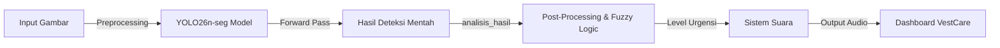

# VestCare - Vest Detection System

## Arsitektur Model YOLO26n-SEG

Arsitektur ini berdasarkan model **YOLO26n-seg** yang merupakan versi nano (n) dari arsitektur YOLO untuk tugas segmentasi. Alur proses arsitektur secara menyeluruh dari input gambar hingga output deteksi adalah sebagai berikut:

### 1. Alur Proses Arsitektur (Secara Menyeluruh)

Flowchart mermaid mendetailkan setiap tahap dari input gambar (512x512x3) hingga output deteksi kelas, bounding box, dan mask segmenisasi:

```mermaid
flowchart LR
    %% Input layer
    I["Input Gambar 512x512x3\n(RGB channels)] --> C1["Conv P1/2\n3x3 kernel, stride 2\nOutput: 256x256x64"]
    C1 --> C2["Conv P2/4\n3x3 kernel, stride 2\nOutput: 128x128x128"]
    C2 --> B1["C3k2 P2/4\nBottleneck C3k2 (2x repeat)\nOutput: 128x128x128"]
    B1 --> C3["Conv P3/8\n3x3 kernel, stride 2\nOutput: 64x64x256"]
    C3 --> B2["C3k2 P3/8\nBottleneck C3k2 (2x repeat)\nOutput: 64x64x256"]
    B2 --> C4["Conv P4/16\n3x3 kernel, stride 2\nOutput: 32x32x512"]
    C4 --> B3["C3k2 P4/16\nBottleneck C3k2 (2x repeat)\nOutput: 32x32x512"]
    B3 --> C5["Conv P5/32\n3x3 kernel, stride 2\nOutput: 16x16x1024"]
    C5 --> B4["C3k2 P5/32\nBottleneck C3k2 (2x repeat)\nOutput: 16x16x1024"]
    B4 --> S["SPPF\nSpatial Pyramid Pooling Fast\n(5x5 pooling, various strides)\nOutput: 16x16x1024"]
    S --> A["C2PSA\nC2 dengan perhatian spasial\nOutput: 16x16x1024"]
    A --> N["Neck\nFitur multi-scale P3/P4/P5\nOutput: Fused features"]
    N --> H["Head Segmentasi\n3 head outputs]\n  - Klasifikasi kelas\n  - Bounding box (x, y, w, h)\n  - Mask segmenisasi\nOutput: Deteksi Classes, Bounding Box, Mask"]
    H --> O["Output: Deteksi\nClasses, Bounding Box, Mask\n5 kelas vestcare + non-target internal"]
```

### 2. Dimensi Ukuran - Detail per Tahap/Lapisan

Tabel lengkap ukuran filter (kernel), tinggi, lebar, dan resolusi output setiap blok arsitektur YOLO26n-seg:

| Tahap / Lapisan | Ukuran Filter (Kernel) | Tinggi | Lebar | Channel | Fungsi & Output Resolusi |
|---|---|---|---|---|---|
| **Input** | - | 512 | 512 | 3 (RGB) | Gambar RGB input 512x512x3 |
| **Conv P1/2** | 3x3 | 256 | 256 | 64 | Konvolusi awal dengan stride 2 untuk mengekstrak fitur dasar (tepi, tekstur); resolusi menjadi 1/2 dari input (256x256x64) |
| **Conv P2/4** | 3x3 | 128 | 128 | 128 | Konvolusi kedua dengan stride 2; memperkaya fitur awal; resolusi 1/4 input (128x128x128) |
| **C3k2 P2/4** | 3x3 (dalam blok) | 128 | 128 | 128 | Blok ekstraksi fitur berbasis bottleneck C3k2 dengan 2 repeat; mengolah pola awal dan meneruskan fitur ke lapisan selanjutnya |
| **Conv P3/8** | 3x3 | 64 | 64 | 256 | Konvolusi dengan stride 2; menurunkan resolusi ke skala 1/8 dari input (64x64x256) |
| **C3k2 P3/8** | 3x3 (dalam blok) | 64 | 64 | 256 | Blok ekstraksi fitur C3k2 pada skala P3/8; memperkuat fitur objek kecil; keluarannya menjadi salah satu masukan neck |
| **Conv P4/16** | 3x3 | 32 | 32 | 512 | Konvolusi dengan stride 2; menurunkan resolusi ke skala 1/16 dari input (32x32x512) |
| **C3k2 P4/16** | 3x3 (dalam blok) | 32 | 32 | 512 | Blok ekstraksi fitur C3k2 pada skala P4/16; memperkuat fitur objek sedang; keluarannya menjadi masukan neck |
| **Conv P5/32** | 3x3 | 16 | 16 | 1024 | Konvolusi dengan stride 2; menurunkan resolusi ke skala 1/32 dari input untuk konteks yang lebih luas (16x16x1024) |
| **C3k2 P5/32** | 3x3 (dalam blok) | 16 | 16 | 1024 | Blok ekstraksi fitur C3k2 pada skala P5/32; memperkuat fitur semantik objek besar sebelum SPPF |
| **SPPF** | Pooling bertingkat | 16 | 16 | 1024 | Spatial Pyramid Pooling - Fast; menggabungkan konteks dari area/reseptif yang lebih luas secara efisien dengan pooling tingkat piramida (k=5) |
| **C2PSA** | 3x3 (dalam blok) | 16 | 16 | 1024 | Blok C2 dengan perhatian spasial (Spatial Attention); memberikan bobot lebih pada area fitur penting sebelum fitur P5 diteruskan ke neck |
| **Neck** | - | - | - | - | Menggabungkan fitur dari P3, P4, dan P5 (multi-scale features) melalui operasi Concat dan Upsample; output fitur fused |
| **Head Segmentasi** | - | - | - | - | Memproses fitur multi-skala untuk menghasilkan prediksi: kelas objek (5 classes), kotak pembatas (bounding box), dan mask segmenisasi |

---

### 3. Fungsi Aktivasi

**SiLU (Swish)** digunakan sebagai fungsi aktivasi utama di seluruh arsitektur YOLO26n-seg.

- Fungsi ini juga dikenal sebagai `swish` dan ditetapkan sebagai `nn.SiLU` dalam implementasi PyTorch.
- **Definisi matematis**: `f(x) = x * sigmoid(x)` atau `f(x) = x / (1 + exp(-x))`
- **Properti utama**:
  - Fungsi yang smooth (tidak seperti ReLU yang memiliki gradien nol di bawah nol)
  - Memiliki area negatif yang non-zero, yang membantu model mempelajari representasi yang lebih baik
  - Berperforma lebih baik dari ReLU dalam beberapa arsitektur deep learning, terutama untuk tugas segmentasi
- Aplikasi di proyek ini: Setiap lapisan konvolusi (`Conv`), blok `C3k2`, `C2PSA`, dan lainnya menggunakan SiLU setelah operasi perkalian dan penjumlahan bias.
- *Catatan*: SiLU dipilih karena empirical evidence menunjukkan performa yang lebih baik dari ReLU dan Swish dalam model YOLO segmenrasi modern.

---

### 4. Batch Normalization (BatchNorm)

- **Batch Normalization tersedia** di setiap konvolusi (Conv layer) di seluruh backbone arsitektur YOLO26n-seg.
- **Setiap lapisan Conv diikuti dengan BatchNorm** untuk normalisasi output terhadap batch, yang membantu stabilisasi training dan mempercepat konvergensi.
- **Struktur blok C3k2** juga menyertakan komponen normalisasi internal (BatchNorm dihimpulkan di dalam blok), sehingga setiap sub-block dalam C3k2 memiliki normalisasi sendiri.
- Tidak ada layer konvolusi secara eksplisit tanpa BatchNorm di susunan arsitektur standar ini.
- **Fungsi BatchNorm**: Melakukan normalisasi terhadap activasi dengan menghitung mean dan variance per batch, kemudian menskalasikan dan mem-shift hasilnya dengan parameter learnable (gamma dan beta). Ini membantu mengatasi masalah internal covariate shift dan memungkinkan learning rate yang lebih besar.

---

### 5. Acuan Sumber dan Framework

#### 5.1 Arsitektur Dasar

- Arsitektur berdasarkan **YOLOv8-seg** dengan adaptasi untuk 5 kelas vestcare (lubang, mobil, motor, orang, pohon).
- Struktur backbone dan neck mengikuti definisi bawaan model YOLO26n-seg dengan modifikasi C3k2 (Conv-C3-kernel-two-times), SPPF, dan C2PSA.
- Diagram dan penjelasan lengkap merujuk pada jurnal arsitektur serta Presentasi PowerPoint yang telah dibagikan sebelumnya.
- Arsitektur default tanpa modifikasi tunai yang signifikan pada struktur utama; penyesuaian utama dilakukan pada jumlah kelas output (5 kelas + 1 kelas internal) dan konfigurasi dataset.

#### 5.2 Framework

- **PyTorch**: Implementasi model dan seluruh operasi training/evaluasi dilakukan menggunakan framework PyTorch melalui library Ultralytics YOLO. Semua operasi tensor, forward pass, backward pass (backpropagation), dan operasi pada lapisan konvolusi, pooling, dan normalisasi dilakukan di dalam PyTorch.
- **Tensor**: Representasi data berupa tensor multidimensi yang mengalir melalui graph komputasi PyTorch. Operasi seperti konvolusi, pooling, activasi (SiLU), dan normalisasi semua bekerja pada tensor ini.
- **Ultralytics YOLO**: Library pengubah yang menyediakan model YO26n-seg, fungsi training, validasi, dan evaluasi. Library ini meng-abstrak kompleksitas PyTorch menjadi API yang lebih sederhana untuk training dan inferensi.
- **Python**: Semua kode server, inferensi, dan pengelolaan dataset ditulis dalam Python 3. Library PyTorch dan Ultralytics diasosiasikan melalui binding Python.

---

### Ringkasan Konfigurasi Training

| Parameter | Nilai |
|---|---|
| **Model** | yolo26n-seg.pt |
| **Ukuran Gambar** | 512 x 512 pixels |
| **Batch Size** | 4 |
| **Epochs** | 100 (maksimal) |
| **Optimizer** | AdamW |
| **Learning Rate (lr0)** | 0.001 |
| **Momentum** | 0.937 |
| **Weight Decay** | 0.0005 |
| **Device** | GPU 0 |
| **Seed** | 0 |
| **Deterministic** | True |

---

### Daftar Kelas Deteksi

Model mendeteksi 5 kelas utama plus kelas internal penolak objek:

| ID Kelas | Nama Kelas | Deskripsi |
|----------|------------|-----------|
| 0 | pohon | Pohon/plant deteksi |
| 1 | mobil | Kendaraan road |
| 2 | motor | Sepeda motor |
| 3 | orang | Orang/dewasa |
| 4 | lubang | Lubang/celah deteksi |
| 5 | __non_target_internal__ | Kelas internal untuk objek yang tidak target |

---

### Alur Proses dari Input hingga Output Deteksi

1. **Input**: Gambar RGB berukuran 512x512x3 dimasukkan ke model
2. **Backbone Feature Extraction**: Melalui rangkaian konvolusi (Conv) dan blok bottleneck (C3k2) dengan penurunan resolusi bertahap (stride 2) dari P1/2 hingga P5/32
   - Setiap lapisan diikuti Batch Normalization untuk stabilisasi
   - Fungsi aktivasi SiLU diterapkan setelah setiap konvolusi
3. **Context Enhancement**: Melalui SPPF (Spatial Pyramid Pooling Fast) untuk mengumpulkan konteks multi-skalanya dari area yang lebih luas
4. **Spatial Attention**: Melalui C2PSA (C2 dengan perhatian spasial) untuk menonjolkan fitur penting sebelum diteruskan ke neck
5. **Neck Integration**: Fitur dari P3, P4, dan P5 digabungkan di Neck layer untuk fitur multi-scale
6. **Head Segmentasi**: Produksi output berupa:
   - Klasifikasi kelas objek (5 kelas: lubang, mobil, motor, orang, pohon)
   - Bounding box (kotak pembatas) dengan confidence score
   - Mask segmenisasi (pengsegmentasian objek)
7. **Post-Processing**: Hasil deteksi di-analisis melalui:
   - Fuzzy logic Sugeno untuk menentukan urgensi level (AMAN/INFO/WASPADA/BAHAYA)
   - Pelacakan gerak pelacak untuk memonitor posisi objek
   - Generasi output suara berdasarkan deteksi dan level urgensi
8. **Output**: Deteksi lengkap dengan confidence score, kelas, mask, dan informasi urgensi yang diproses ke sistem suara

---

### Pipeline Inferensi Lengkap



---

### Sistem Post-Processing & Suara

Setelah model menghasilkan deteksi, langkah-langkah berikut dilakukan:

1. **analisis_hasil**: Mengolah output model untuk mengekstrak deteksi yang valid
2. **Pelacak Gerak**: Melacak gerak objek across frames untuk stabilitas deteksi
3. **validasi_nama_kelas**: Memastikan nama kelas sesuai ekspektasi
4. **Perencanaan Suara**: Menentukan segment suara yang sesuai berdasarkan:
   - Level ketegangan (level: AMAN/INFO/WASPADA/BAHAYA)
   - Arah objek (kiri, depan, kanan)
   - Jarak objek (5cm - 50cm dalam bucket 5)
   - Jenis objek (benda_xxx_xxx_netral)
5. **Generasi Suara**: Mengoutputkan klip suara yang sesuai untuk notifikasi pengguna

---

### Konfigurasi Sistem

| Setting | Nilai Default | Keterangan |
|---------|--------------|------------|
| **Confidence Threshold** | 0.35 | Ambang batas kepercayaan deteksi |
| **Confidence Ragu** | 0.50 | Ambang batas untuk kelas "ragu" |
| **Image Size** | 512 | Ukuran input gambar (px) |
| **API Key** | Di .env | Minimal 32 karakter acak |
| **Port** | 8080 | Port server API |
| **GPU Device** | 0 | Device GPU yang digunakan |
| **Supabase Connection** | Sesuai .env | Untuk menyimpan riwayat deteksi |

---

### Persyaratan Sistem

- **Python**: 3.9+ recommended
- **PyTorch**: Versi yang kompatibel dengan Ultralytics YOLO
- **Ultralytics YOLO**: Library untuk model dan training
- **FastAPI**: Framework server API
- **Uvicorn**: ASGI server
- **Cloudflare CLI** (opsional): Untuk tunnel publik
- **Supabase** (opsional): Untuk penyimpanan riwayat dan dashboard

---

### Cara Menjalankan

1. **Setup Environment**:
   ```bash
   cd VestCare-Vest-Detection-Stage-2
   python -m venv .venv
   .venv\Scripts\activate
   pip install -r requirements.txt
   ```

2. **Konfigurasi**:
   - Salin `.env.example` menjadi `.env`
   - Isi VEST_API_KEY dengan kunci acak 32+ karakter
   - Sesuaikan VEST_MODEL_PATH jika perlu

3. **Training Model** (jika perlu):
   ```bash
   python start_train.py
   # atau
   python server_rest_api.py train
   ```

4. **Jalankan Server**:
   ```bash
   python server.py
   # Server akan berjalan di http://127.0.0.1:8080
   # Dokumentasi API: http://127.0.0.1:8080/docs
   ```

5. **Test Deteksi**:
   ```bash
   # Melalui API
   curl -X POST "http://127.0.0.1:8080/api/deteksi/latest" \
        -H "X-API-Key: <API_KEY>" \
        -F "file=@gambar.jpg"
   ```

---

### Struktur Proyek Penting

```
VestCare-Vest-Detection-Stage-2/
├── models/           # File bobot model (.pt)
├── server.py         # Main FastAPI server
├── server_rest_api.py # REST API endpoints
├── train_semua.py    # Modul training utama
├── start_train.py    # Entry point training
├── start_eval.py     # Evaluasi model
├── data/             # Dataset dan konfigurasi
├── library/          # Library suara dan fuzzy logic
│   └── suara-natural-ai/ # Audio processing
├── web/              # Frontend dashboard React
├── .env              # Environment configuration
└── README.md        # Dokumentasi ini
```

---

## Penerbitan dan Lokasi Implementasi Code

Bagian-bagian di atas merangkum dokumentasi arsitektur. Berikut adalah lokasi referensi implementasi di dalam kode program:

| File Python | Baris | Keterangan Fungsional |
|-------------|-------|----------------------|
| **train_semua.py** | **19** | `from ultralytics import YOLO` — Impor library Ultralytics untuk memuat model YOLO26n-seg |
| **train_semua.py** | **1260** | `model.train(MODEL, ...)` — Sini model di-train dengan arsitektur yang sudah termasuk fungsi aktivasi **SiLU** secara bawaan PyTorch/Ultralytics |
| **server_rest_api.py** | **167** | `from ultralytics import YOLO` — Digunakan saat inferensi/server berjalan untuk memuat model dan melakukan forward pass |
| **start_train.py** | **17** | `from train_semua import main` — Entry point yang memanggil fungsi training utama |

**Catatan tentang SiLU**: Fungsi aktivasi **SiLU (Swish)** bukan didefinisikan secara eksplisit dalam file-file Python proyek VestCare, melainkan **bawaan library PyTorch** (`torch.nn.SiLU`). Ketika model `yolo26n-seg.pt` di-load dan dieksekusi (baik saat training di `train_semua.py:1260` maupun inferensi di `server_rest_api.py:167`), setiap lapisan konvolusi dan blok arsitektur (C3k2, C2PSA, dll.) secara otomatis menggunakan SiLU sebagai fungsi aktivasi-nya, sebagaimana telah ditetapkan dalam definisi arsitektur model YOLO26n-seg.