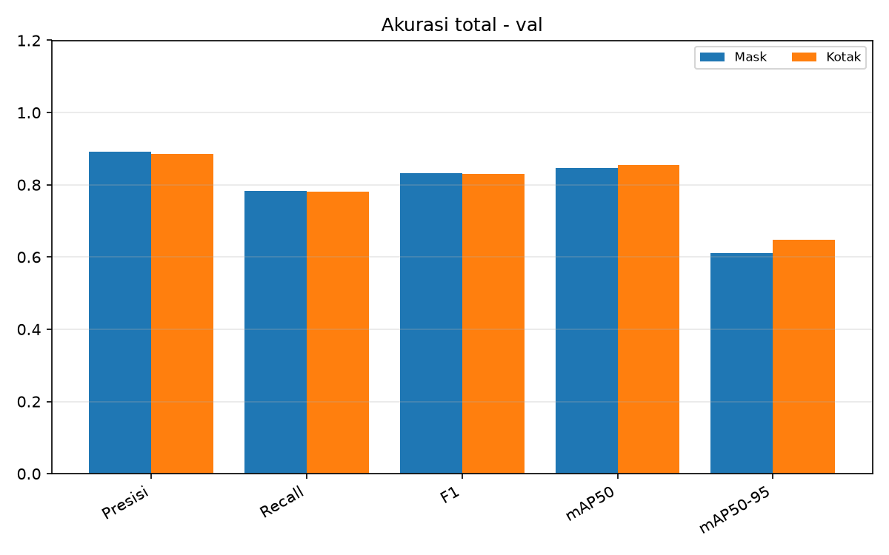
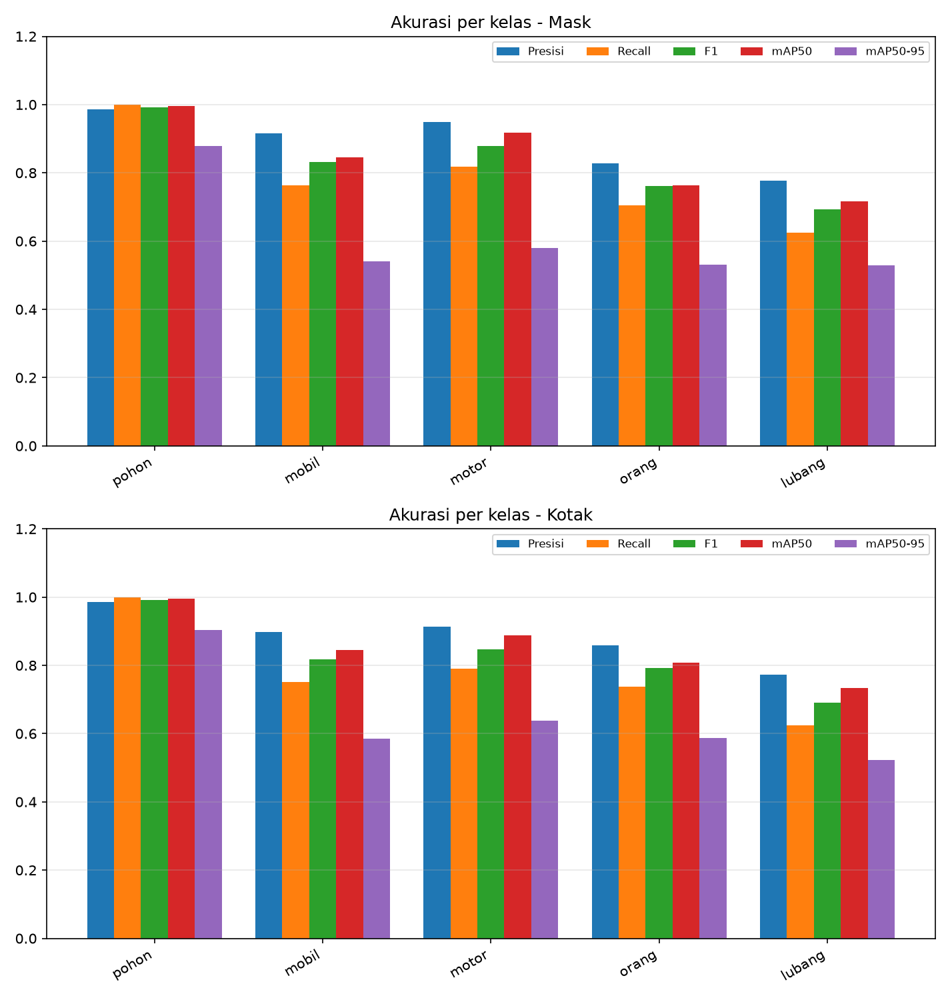
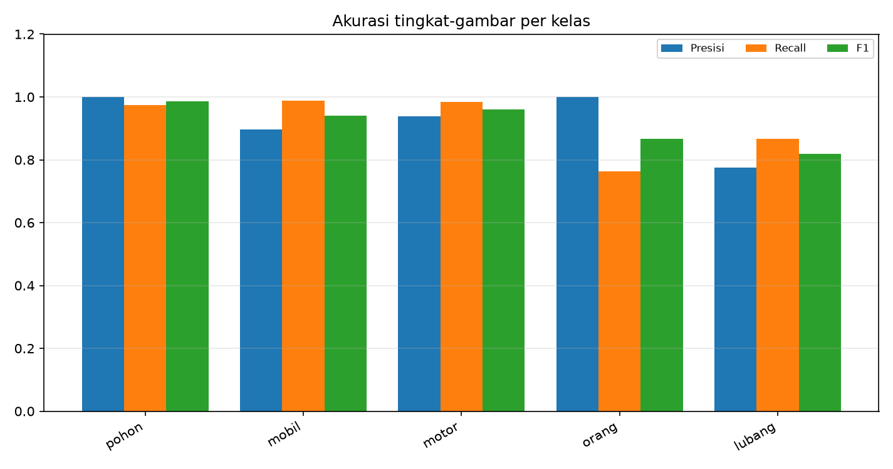
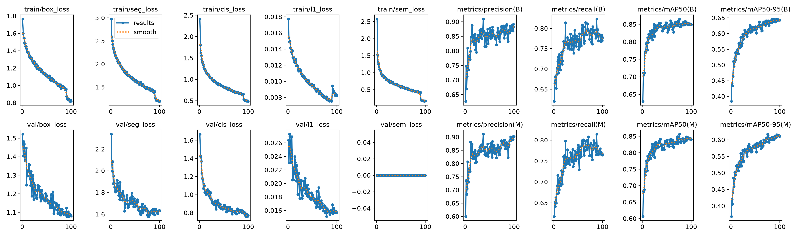

# Hasil Training VestCare - Run Final

Dokumen ini merangkum run `semua_kelas_yolo26n_20261107_154452`, yang disimpan bersama artefaknya di folder ini. Angka evaluasi di bawah berasal dari checkpoint terbaik (`best.pt`) dan split validasi.

## Ringkasan run

| Informasi | Nilai |
|---|---|
| Model | YOLO26n-seg |
| Tugas | Object detection dan instance segmentation |
| Kelas keluaran | 5 |
| Epoch | 100 dari 100 |
| Waktu training | 29.825,4 detik (sekitar 8 jam 17 menit) |
| Checkpoint terbaik | `weights/best.pt` (berkas lokal; tidak disertakan dalam push ini) |
| Checkpoint terakhir | `weights/last.pt` (berkas lokal; tidak disertakan dalam push ini) |
| Hasil evaluasi | Split validasi (`val`) |

## Dataset dan persiapan data

Run ini menggabungkan lima dataset utama, masing-masing untuk satu kelas target. Catatan training hanya menunjukkan lima kelas keluaran; dataset penunjang tidak tercatat sebagai kelas keluaran pada run ini.

| ID kelas | Kelas | Dataset utama |
|---:|---|---|
| 0 | pohon | Dataset pohon |
| 1 | mobil | Dataset mobil |
| 2 | motor | Dataset motor |
| 3 | orang | Dataset orang |
| 4 | lubang | Dataset lubang |

| Split | Jumlah gambar | Background tanpa objek berlabel | Keterangan |
|---|---:|---:|---|
| Train | 2.778 | 101 | Digunakan untuk pembaruan bobot |
| Validasi | 312 | 12 | Digunakan untuk memantau dan mengevaluasi model |
| Total | 3.090 | 113 | Tidak ada overlap gambar train-validasi |
| Test independen | Tidak tercatat | - | Run ini melaporkan evaluasi pada `val`, bukan split `test` |

Pembagian yang tercatat setara dengan sekitar 89,9% train dan 10,1% validasi. Pembagian menggunakan seed 0. Konfigurasi dataset yang tercatat adalah `dataset_gabungan.yaml`. File [`reports/training_report.json`](reports/training_report.json) menyimpan jumlah gambar dan informasi split run.

Jumlah gambar validasi per kelas berikut dapat saling tumpang tindih karena satu gambar dapat memuat lebih dari satu kelas.

| Kelas | Gambar validasi | Instance |
|---|---:|---:|
| pohon | 76 | 76 |
| mobil | 87 | 269 |
| motor | 61 | 358 |
| orang | 93 | 281 |
| lubang | 60 | 88 |

## Konfigurasi training

| Kelompok | Parameter | Nilai |
|---|---|---|
| Input | Ukuran gambar | 512 x 512 |
| Input | Batch | 4 |
| Input | DataLoader workers | 0 |
| Proses | Device | CUDA:0 |
| Proses | Seed training / deterministic | 0 / aktif |
| Proses | Cache | Nonaktif |
| Proses | Epoch maksimum / patience | 100 / 50 |
| Model | Bobot awal | `yolo26n-seg.pt` (pretrained) |
| Optimizer | Jenis | AdamW |
| Optimizer | Learning rate awal (`lr0`) | 0,001 |
| Optimizer | Learning rate akhir (`lrf`) | 0,01 |
| Optimizer | Momentum | 0,937 |
| Optimizer | Weight decay | 0,0005 |
| Augmentasi | Mosaic / flip kiri-kanan | 1,0 / 0,5 |
| Augmentasi | Rotasi / translasi / skala | 10 derajat / 0,1 / 0,5 |
| Augmentasi | MixUp / Copy-Paste | 0 / 0 |
| AMP | Konfigurasi | Diminta aktif, tetapi dinonaktifkan otomatis oleh pemeriksaan kompatibilitas GPU |

### Perangkat dan software

| Komponen | Versi / perangkat |
|---|---|
| GPU | NVIDIA GeForce GTX 1650 with Max-Q Design, VRAM 4.096 MiB |
| Python | 3.12.10 |
| PyTorch | 2.14.1+cu130 |
| Ultralytics | 8.4.195 |
| CUDA | Device 0 |

## Backbone dan arsitektur model

Backbone mengekstrak fitur gambar pada beberapa skala. Feature map P3, P4, dan P5 kemudian digabungkan oleh neck, lalu head segmentasi menghasilkan kotak deteksi dan mask untuk lima kelas.

| Bagian | Blok / tahap | Fungsi |
|---|---|---|
| Input | Gambar RGB 512 x 512 x 3 | Masukan model |
| Backbone awal | Conv dan C3k2, P1/2 hingga P3/8 | Ekstraksi fitur dasar dan detail objek |
| Backbone tengah | Conv dan C3k2 pada P4/16 | Ekstraksi fitur objek ukuran menengah |
| Backbone akhir | Conv dan C3k2 pada P5/32 | Ekstraksi fitur konteks objek yang lebih besar |
| Konteks | SPPF | Menggabungkan konteks spasial pada beberapa receptive field |
| Atensi | C2PSA | Memperkuat fitur spasial yang relevan |
| Neck | Upsample, concat, C3k2, dan downsample | Fusi fitur multiskala P3, P4, dan P5 |
| Head | Segment26 | Prediksi kelas, bounding box, dan mask segmentasi |

| Ringkasan model | Nilai |
|---|---:|
| Kedalaman | 309 layer |
| Parameter | 3.054.875 |
| GFLOPs | 10,3 |
| Bobot pretrained yang dipindahkan | 830 dari 844 |

## Hasil evaluasi dan grafik akurasi

Evaluasi detail dilakukan pada 312 gambar validasi menggunakan `best.pt`. Nilai mAP adalah metrik deteksi/segmentasi, bukan akurasi klasifikasi biasa.

| Jenis prediksi | Precision | Recall | F1 | mAP50 | mAP50-95 |
|---|---:|---:|---:|---:|---:|
| Bounding box | 88,51% | 78,06% | 82,95% | 85,41% | 64,77% |
| Mask segmentasi | 89,08% | 78,22% | 83,30% | 84,76% | 61,18% |

Akurasi tingkat-gambar tercatat 80,45% (251 dari 312 gambar benar, pada confidence 0,25). Grafik berikut memperlihatkan precision, recall, dan F1 tingkat-gambar untuk setiap kelas.

| Kelas | Box mAP50 | Mask mAP50 | Catatan |
|---|---:|---:|---|
| pohon | 99,50% | 99,50% | Hasil tertinggi |
| mobil | 84,56% | 84,49% | Recall masih dapat ditingkatkan |
| motor | 88,82% | 91,82% | Hasil mask kuat |
| orang | 80,81% | 76,28% | Perlu peningkatan recall |
| lubang | 73,36% | 71,69% | Kelas terlemah; perlu tambahan/perbaikan data |

## Kurva training dan kecepatan

| Pengukuran | Hasil |
|---|---:|
| Latensi rata-rata | 17,21 ms/gambar |
| FPS rata-rata | 58,1 |
| Pengukuran kecepatan | 100 gambar, batch 1, termasuk preprocessing dan postprocessing |

## Kesimpulan

Model menyelesaikan seluruh 100 epoch dan mencapai box mAP50 85,41% serta mask mAP50 84,76% pada validasi. Kinerja terbaik ada pada kelas pohon dan motor. Kelas orang dan lubang menjadi prioritas perbaikan berikutnya, terutama recall dan kualitas mask. Hasil ini adalah hasil validasi; tidak ada hasil split test independen yang tercatat untuk run ini.

## Artefak

| Artefak | File |
|---|---|
| Bobot terbaik | `weights/best.pt` (berkas lokal; tidak disertakan dalam push ini) |
| Bobot epoch terakhir | `weights/last.pt` (berkas lokal; tidak disertakan dalam push ini) |
| Grafik hasil training | [`results.png`](results.png) |
| Metrik per epoch | [`results.csv`](results.csv) |
| Parameter run | [`args.yaml`](args.yaml) |
| Log training | `training_semua_20261107_154452_851599.log` (berkas lokal; tidak disertakan dalam push ini) |
| Ringkasan evaluasi | [`evaluation/final/ringkasan_test.json`](evaluation/final/ringkasan_test.json) |
| Laporan akurasi teks | [`evaluation/final/laporan_akurasi.txt`](evaluation/final/laporan_akurasi.txt) |

README ini menyertakan grafik dan metadata ringkas. Checkpoint model dan log mentah tetap tersedia di folder lokal `run_final`, tetapi tidak dimasukkan ke commit GitHub.
